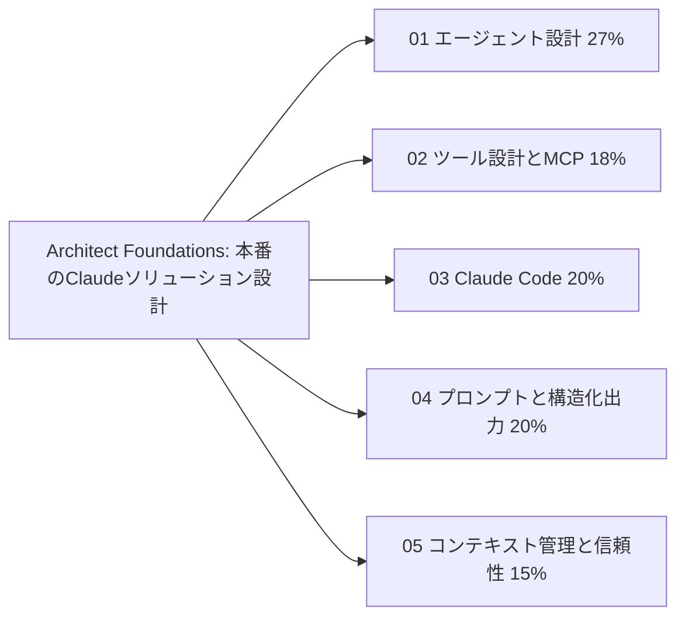
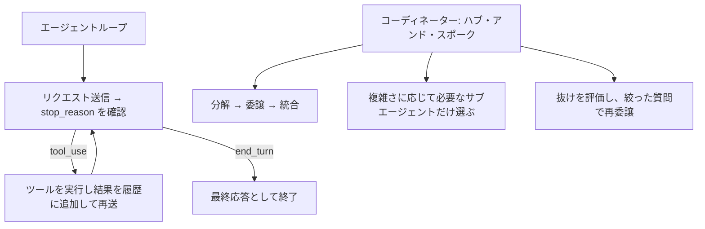
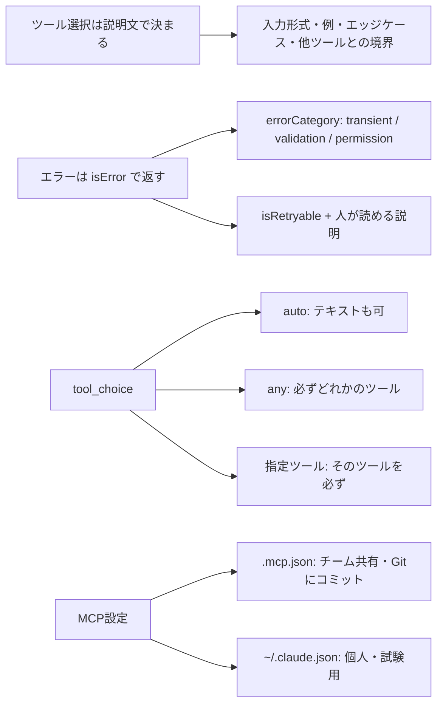
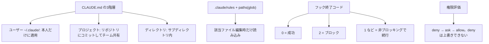
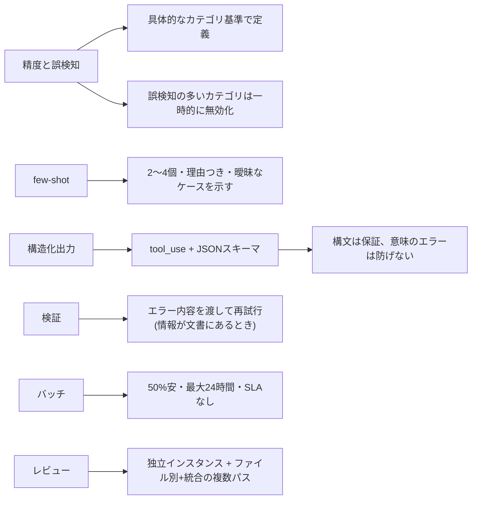
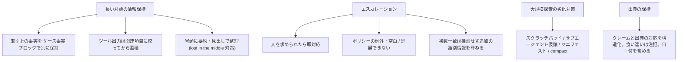

# Architect – Foundations: 覚える内容の俯瞰図

5ドメインで問われる内容を、図(流れ・構造)と表(覚える項目・正答の型・よくある誤答)で整理したページです。
根拠は各ドメインの `topics/*/notes.md` と、練習問題(78問)の正答です。シナリオ形式の試験(本番は6シナリオから4つ出題)なので、各項目は「状況 → 正しい設計判断」の形で覚えます。

## 全体像

全ドメインを貫く判断の型は次の4つです。

| 判断の型 | 正答になる設計 |
|---|---|
| 守らせたいルールの置き場所 | 金銭・安全に関わる決定的な遵守は、フックや前提条件のゲート(プログラム)で強制する。プロンプトの指示は確率的 |
| 情報の受け渡し | サブエージェントは親のコンテキストを引き継がない。必要な情報は、出典メタデータと分けた構造化データでプロンプトに入れる |
| 失敗の伝え方 | 種類・試した内容・部分的な結果・代替案を構造化して返す。一律の失敗メッセージや、黙って空の結果を返すのは誤り |
| 検証の独立性 | 生成したセッションとは別の独立したインスタンスで検証する。自己申告の確信度や感情は当てにしない |

---

## 01. エージェント設計とオーケストレーション(27%、最重要)

| 覚える項目 | 正答の型 | 誤答になりやすい例 |
|---|---|---|
| ループの制御 | `stop_reason` が `"tool_use"` なら実行して継続、`"end_turn"` なら終了 | 応答テキストの文言(「完了しました」)で判定 / テキストの有無で判定 / 反復回数の上限が主な終了条件 |
| 反復回数の上限 | 暴走防止の安全網としては有効だが、主たる終了条件にはしない | — |
| 大量ソースの調査 | オーケストレーターが調査をサブエージェントに並列委譲し、各自が要約のみを返す | 1エージェントが全ソースを1コンテキストに蓄積 / 人が事前に要約 |
| マルチエージェントが非効率 | タスクの独立性が乏しく、並列化の利点が薄いのに、委譲とコンテキスト複製のオーバーヘッドだけが乗った | モデルが古い / 実装のバグ |
| ハブ・アンド・スポーク | コーディネーターが通信・エラー処理・情報の経路を管理する。サブエージェント同士は直接やりとりしない(観測しやすい) | サブエージェント同士の直接通信 |
| 統合担当が結果を反映しない | サブエージェントは親のコンテキストを自動では引き継がない。検索結果を統合担当のプロンプトに含める | 「必ず使え」と書く / メモリ共有を有効化 |
| 抜けがある調査 | 根本原因はコーディネーターがテーマを狭く分解して割り当てたこと | 検索ツールの故障 / モデル性能 |
| 重複調査 | コーディネーターが調査範囲をサブトピックや情報源の種類ごとに分割して割り当てる | 各エージェントに全範囲を調べさせて比較 |
| 複雑さが様々な依頼 | 依頼の複雑さを分析し、必要なサブエージェントだけを動的に選んで呼び出す | 全員を固定順序で通す / 固定の3段階構成 |
| 並列起動 | 1回のコーディネーター応答の中で複数のTaskツール呼び出しを出す。ターンをまたぐと並列にならない。`allowedTools` に `"Task"` が必要 | 別々のターンで順番に出す / 1つにまとめて逐次 |
| 金銭操作の前提条件 | 本人確認済みの顧客IDが返るまで、返金ツールの呼び出しをプログラムでブロックするゲートを実装 | 強い口調で繰り返し書く / 自己確認させる / ツール説明に書く |
| 返金額の上限 | ツール呼び出しを横取りするフックで、しきい値超過をブロックし人間へエスカレーション | 返金ツールを外す / プロンプトで強調 |
| データの正規化 | `PostToolUse` フックでツール結果(日時・ステータス)を統一形式に変換してからモデルに渡す | 追加のツール呼び出し / システムプロンプトに形式を列挙 |
| 複数の用件 | 個別の項目に分け、共有コンテキストで並列に調査し、1つの回答に統合 | 最初の用件だけ処理 / 順番に別々の返信 |
| 人への引き継ぎ | 担当者は会話記録を見られない。顧客ID・根本原因・返金額・推奨対応を含む構造化サマリーを渡す | 一文だけ / 全文を貼る / 顧客に説明し直させる |
| 承認ゲート | 返金など不可逆で金銭的影響のある操作だけ人の承認を置く。検索やFAQは自律実行(全操作承認は承認疲れ) | 全ツールを承認必須 / 完全自律+事後監査 |
| 手順の分解 | 予測できる手順=プロンプトチェイニング / 探索的=動的に次のサブタスクを生成 | — |
| 大規模コードレビュー | ファイルごとの局所分析パスと、ファイル間の統合パスに分ける(注意の希薄化を避ける) | 重要な3ファイルだけ / 大きなコンテキストのモデルに替える |
| 長時間タスクの中断 | 進捗と完了済みタスクを外部(ファイルやDB)にチェックポイントとして保存 | コンテキストを最大化 / 無制限リトライ |
| セッションの扱い | 再開(`--resume <名前>`)は文脈が有効なとき。ツール結果が古いなら、構造化サマリーで新規セッション。分岐は `fork_session` | 何も伝えず再開 / 調査結果を破棄して最初から |
| エラー回復 | 429のような一過性は指数バックオフで自動リトライ。401のような恒久的エラーは再試行せず人へ | 全エラーを即エスカレーション / 同じロジックで再試行 |
| コスト面 | マルチエージェントはスループットを上げるが、各サブエージェントが独自のコンテキストを持つのでトークンコストが増える。独立性のあるタスクにだけ使う | — |

## 02. ツール設計とMCP(18%)

| 覚える項目 | 正答の型 | 誤答になりやすい例 |
|---|---|---|
| 似たツールで選択が不安定 | 機能の重複がなくなるよう名前と説明を見直し、用途・入力・境界を区別する。汎用ツールは目的別に分割 | 片方を削除 / 説明を短くする / 「迷ったらこちら」とプロンプトに書く |
| システムプロンプトの影響 | キーワードに反応する指示が、意図しないツールとの結びつきを生み、ツール説明を上書きすることがある | — |
| 失敗の返し方 | `isError` で返し、エラー種別・再試行の可否・人が読める説明を構造化して含める | 「失敗しました」だけ / ログにだけ記録 |
| ビジネスルール違反 | `isError` で失敗を示し、再試行不可と、顧客に伝えられる説明を含める | 一過性エラーとして再試行させる / 空の結果を成功として返す |
| 空の結果 | アクセス失敗(再試行の判断が必要)と、有効な空の結果(照会は成功したが一致なし)を区別して報告 | 失敗を無視 / 失敗を空の結果と同じ扱い |
| ツールの数と配分 | 多すぎると選択精度が落ちる(4〜5個で足りるのに18個)。役割に必要なツールだけ渡す | 検索・Webアクセスの権限をすべて統合エージェントに |
| 横断ツール | 統合エージェントに限定した事実確認ツール(`verify_fact`)を与え、複雑なケースだけコーディネーター経由 | 追加確認をなくす |
| `tool_choice` の使い分け | `auto`=呼ばないこともある / `any`=必ずどれかを呼ぶ(文書の種類が不明で複数スキーマがあるとき) / 指定=特定処理を最初に実行 | — |
| 必ずツール呼び出しにしたい | `"any"` を設定する | `"auto"` / プロンプトで書くだけ / 請求書ツールを全文書に強制 |
| SQLツールの懸念 | スキーマが任意のSQL文字列を許し、最小権限に反して悪用リスクが高い | 応答速度 / 説明文の長さ / ツール名の言語 |
| MCPのスコープ | プロジェクト `.mcp.json`=チーム共有、ユーザー `~/.claude.json`=個人用 | — |
| 秘密情報 | `.mcp.json` の headers で `${API_KEY}` のように環境変数を参照する。値は書かずコミットしない | APIキーを直書き / チャットで配布 |
| 同名サーバー | `local` → `project` → `user` の順で、優先される定義が丸ごと使われる(マージされない) | 両方マージ / どちらも読み込まれない |
| ツール名 | `mcp__<サーバー名>__<ツール名>`。権限ルールやフックのマッチャーに使う | — |
| 大きな出力 | 10,000トークンで警告、既定25,000が上限。ページングや絞り込み引数をサーバー側に追加する | 上限を最大に引き上げる / タイムアウトを延ばす |
| annotations | 信頼できるサーバーから得たものでない限り信頼しない。承認は省略しない | 仕様上の保証として承認を省略 |
| MCPの調達 | Jiraなど標準的な連携は既存MCPサーバー。自作は自社固有のワークフローに限る | すべて自作 / 全部1つのカスタムに統合 |
| MCPツールが使われない | ツールの説明を充実させ、機能・入力・出力と組み込みツールとの違いを明確に | 名前を短く / 組み込みGrepを無効化 |
| トランスポート | 複数クライアントが共有するならリモート(HTTP)。認証・認可をネットワーク越しに扱う | stdioで認証不要 / どちらでも同じ |
| 組み込みツール | Grep=内容検索 / Glob=パス検索(`**/*.test.tsx`) / Edit=一意なテキストの部分変更 / Read+Write=全体の読み書き | — |
| Editが失敗 | 一致が一意でないとき、Readで全体を読みWriteで書き込む | 同じEditを再試行 / sed / 削除して作り直し |
| コードベース理解 | Grepで入り口を探し、Readでimportを追う。最初に全ファイルを読まない | — |

## 03. Claude Code の設定とワークフロー(20%)

| 覚える項目 | 正答の型 | 誤答になりやすい例 |
|---|---|---|
| 新メンバーに指示が効かない | ユーザーレベルの指示は共有されない。規約はプロジェクトのCLAUDE.mdに移してコミット | 口頭/チャットで共有 / 再インストール / 毎回プロンプトに貼る |
| 構成の共有 | 許可ツール・MCP構成は、プロジェクトレベルの設定としてリポジトリにコミット | 各自が手書き / Wikiに記載 |
| CLAUDE.md のモジュール化 | `@import` で外部ファイルを参照。`.claude/rules/` でトピック別に分ける。`/memory` で読み込み状況を確認 | — |
| コマンドの場所 | `.claude/commands/`=プロジェクト(共有) / `~/.claude/commands/`=個人 | — |
| スキル | `.claude/skills/` の `SKILL.md` frontmatter。`context: fork`=隔離して実行 / `allowed-tools`=使えるツールを制限 / `argument-hint`=引数を促す | CLAUDE.mdに移す / `allowed-tools` を空に |
| スキルとCLAUDE.md | スキル=必要なときに呼ぶタスク固有の手順 / CLAUDE.md=常時読み込む普遍的な標準 | — |
| 散らばるファイルへの規約 | `.claude/rules/` の `paths` に `**/*.test.tsx` のようなglobを書き、条件付きで読み込む | ディレクトリごとに同じCLAUDE.mdを置く / ルート1つに全部 |
| 長い出力のスキル | frontmatter に `context: fork` を指定して隔離したサブエージェントで実行 | — |
| プランモード vs 直接実行 | 大規模・複数案・アーキテクチャ判断=プランモード / 範囲が明確な小さな変更=直接実行 / 調査と計画はプラン、実装は直接実行 | 小さなバグ修正でもプラン(修正方針) |
| 大規模な方式移行 | プランモードで探索して設計し、合意した計画を実装する | すぐ直接実行 / 設計を省く |
| 説明が伝わらない | 入出力の具体例(2〜3個)、テスト駆動、インタビューパターン(Claudeに質問させる) | 条件を増やして詳しく書く |
| 実装前の考慮漏れ | インタビューパターンで、キャッシュの無効化方針や障害モードなどを引き出す | 要件を詳細に書く / 先に実装 |
| 問題の伝え方 | 互いに影響する問題=1つの詳細なメッセージ / 独立した問題=順番に1つずつ | — |
| CIでの実行 | `-p`(`--print`)で非対話に実行し、`--output-format json` と `--json-schema` で構造化出力を得る | `--resume` / 対話モード / プランモード |
| CIでの権限モード | `dontAsk`+必要なツールだけを `permissions.allow` に明示。共有ランナーで `bypassPermissions` は危険 | `acceptEdits` / `default`で人の入力を待つ |
| 再レビュー | 前回の指摘をコンテキストに含め、新しい指摘と未対応の指摘だけを報告させる | 件数制限 / 頻度を減らす / 過去コメントを削除して再投稿 |
| テスト生成 | 既存のテストファイルをコンテキストに含め、重複しないものだけ生成させる。対象の関数・境界値・異常系を明示 | — |
| フックの終了コード | `0`=成功 / **`2`=ブロック(stderrがClaudeに返る)** / それ以外(`1`含む)=非ブロッキングで続行。`PostToolUse` は実行後なので止められない | 終了コード1でブロックを期待 / `PostToolUse` でブロック・取り消し |
| フックの保存場所 | `~/.claude/settings.json` / `.claude/settings.json`(コミット可) / `.claude/settings.local.json` / managed policy | — |
| 権限評価 | deny → ask → allow の順。範囲の狭いallowでdenyの例外は作れず、どのスコープでも他のレベルのallowで覆せない。managed settingsが最上位 | コマンドライン引数が最優先 / 狭いallowが優先 / 確認が表示される |
| 権限モード | `default`=初回確認 / `acceptEdits`=編集を自動承認 / `plan`=読み取りのみ / `auto`=分類器が確認 / `dontAsk`=確認が要る操作は自動拒否 / `bypassPermissions`=隔離環境のみ | — |
| サブエージェント定義 | Markdown+frontmatter(必須は `name` `description`)。`tools` で制限(省略すると継承)。チーム共有は `.claude/agents/` にコミット | 各自の `~/.claude/agents/` にコピー / `bypassPermissions` / ツールを継承 |
| サブエージェントの特性 | 独立したコンテキストで動き、メインには最終要約だけ戻る。Explore=読み取り専用検索。同時実行はデフォルト最大20、入れ子は最大3階層 | — |
| 組織導入 | 個人利用で有効だった設定をプロジェクト設定・フック・CLAUDE.mdとして定着させ、チーム単位で標準化してから段階的に展開 | 各自の自由 / 全リポジトリへ一律強制 / ゼロから設計し直し |
| 構成の整理 | 共通の指示=ルートCLAUDE.md、パッケージ固有=該当ディレクトリのCLAUDE.md、またはパスを限定した `.claude/rules/` | — |
| 共有コマンド | `.claude/commands/` に定義してコミット。対象を引数で渡し、必要な許可ツールを定義側で明示 | — |
| 危険コマンドの確実な阻止 | フックで危険なコマンドパターンを検知しブロック。モデルの判断とは独立に実装 | システムプロンプトの注意書き / 高性能モデルに替える / 毎回人が確認 |
| フックのコマンド | 危険なコマンドを検出したら終了コード2で終了し、理由をstderrに出力 | 終了コード1 / 常に0でstdoutに警告 / `PostToolUse` で取り消し |

## 04. プロンプトと構造化出力(20%)

| 覚える項目 | 正答の型 | 誤答になりやすい例 |
|---|---|---|
| 誤検知が多い | 報告すべき問題(バグ・セキュリティ)とスキップすべき問題(軽微なスタイル)を具体的な基準で定義する | 「保守的に」と強める / 確信度90%以上と書く / 件数に上限 |
| 誤検知カテゴリ | そのカテゴリを一時的に無効にして信頼を回復しつつ、具体例を加えて評価データで再評価 | — |
| 出力がばらつく | few-shot(2〜4個の的を絞った例)。理由も添え、曖昧なケースの扱いと許容パターンを示す | 指示を長くして例外を網羅 / 温度を0にして様子見 |
| 構造が不安定な文書の抽出 | 様々な文書構造から正しく抽出した2〜4個のfew-shot例を示す | 例外文書を除外 |
| 構造化出力 | `tool_use`+JSONスキーマ。JSON構文エラーがなくなる | プロンプトだけで依頼 |
| スキーマの限界 | 防げるのは構文エラーだけ。合計の不一致など意味のエラーは防げない | `tool_choice: auto` で解決 |
| 合計の不一致 | 計算した合計(`calculated_total`)と文書記載の合計(`stated_total`)を両方抽出して比較し、食い違いを検出。矛盾時は `conflict_detected` | スキーマを厳格にして防ぐ / 合計項目を削除 |
| 情報がないかもしれない項目 | 任意(nullable)にして、なければnullを返せるようにする。必須だと値をでっち上げる | 必須のまま繰り返し指示 / ダミー文字列「N/A」 |
| スキーマ設計 | 必須と任意を意識。拡張できる分類は `"other"`+詳細文字列。曖昧用に `"unclear"` のenum | — |
| 形式のばらつき | スキーマで構造を強制し、正規化ルール(通貨記号を除き数値だけ等)もプロンプトに書く | スキーマなしで下流が吸収 / 人が手直し |
| 再試行 | 元文書・失敗した抽出結果・具体的な検証エラーを渡す。必要な情報が文書にないときは効かない | 無制限に再試行 / 推測で埋める / 欠損をそのまま通す |
| 情報が文書にない項目 | 再試行しても改善しないので、不明として扱い、必要なら人に回す | — |
| バッチAPIの特性 | 50%安い、最大24時間、遅延SLAなし。ブロックしない処理向け。ツールの複数ターンは不可。`custom_id` で対応づけ | マージ前チェックにバッチ |
| 同期かバッチか | マージをブロックするチェック=同期API / 夜間のテスト生成=Batches API | 両方バッチ / 両方同期 |
| 月曜朝までの処理 | Message Batches APIで非同期処理し、コストを半分にする | ストリーミング / 小さいモデルに必ず切り替え |
| 自己レビューの限界 | 生成時の推論の文脈を持つため疑いにくい。独立したレビュー用インスタンスの方が微妙な問題を見つけやすい | 同セッションで厳しくと指示 / 拡張思考 / 繰り返し回数を増やす |
| 大規模レビュー | 独立インスタンス+ファイル別の局所パスと統合パスに分ける | テストが通れば合格 |
| 検証パス | 各指摘に自己申告の確信度を出させ、確信度に応じて振り分ける | — |
| 自己申告の確信度 | 複雑さの指標として信頼できない。全体精度(97%など)は区分別の弱点を隠す | 全体精度が高いので自動化 |

## 05. コンテキスト管理と信頼性(15%)

| 覚える項目 | 正答の型 | 誤答になりやすい例 |
|---|---|---|
| 要約で金額・期限が曖昧に | 取引上の事実(金額・日付・注文番号・ステータス)を、要約とは別の「ケース事実」として毎回のプロンプトに含める | 要約頻度をさらに上げる / 大きなモデルで要約せず全履歴を保持 / 古いターンを破棄 |
| 長い入力 | 「lost in the middle」で中間が抜けやすい。冒頭に要点を置き、見出しで整理 | — |
| ツール出力の蓄積 | 蓄積する前に関連項目だけに絞る(40項目返るが必要なのは5項目) | — |
| 人間を求められた | 調査を試みる前にすぐ従う。問題が単純なら解決を申し出てもよい | 先に解決して要求を取り下げてもらう / 確信度が低いときだけ / 感情分析 |
| 不満だが能力の範囲内 | 共感しつつ解決を申し出て、顧客が改めて人間を希望したときだけエスカレーション | 感情分析のしきい値で自動引き継ぎ / まず人へ |
| ポリシーに書かれていない | 推測で判断せず、人間にエスカレーションする(競合他社の価格対応の例) | 類推して対応 / 要望に応じられないと案内 |
| 顧客が複数ヒット | ヒューリスティックで選ばず、追加の識別情報(メール・注文番号)を尋ねて確認 | 最近の注文の顧客を選ぶ / 先頭を選ぶ / 3件すべて処理 |
| エラー伝播 | 失敗の種類・試したクエリ・部分的な結果・代替案を含む構造化したエラーコンテキストを返す | 失敗を伏せて空の結果を成功として返す / 一般的なステータスだけ / 処理を中断 |
| 空の結果と失敗 | アクセス失敗と有効な空の結果を区別して報告。サブエージェントは一過性の障害をローカルで回復し、解決できないものだけ伝播 | 1回失敗したらワークフロー全体を終了 |
| カバレッジ注記 | 統合の出力に、裏付けのある発見と、情報源が使えず空白のトピックの区別を付ける | — |
| 長いセッションの劣化 | 「典型的なパターン」に言及し始めたら: 主要な発見をスクラッチパッドに記録して参照し、冗長な探索はサブエージェントに委譲 | 全ファイルを先に読む / 調査を続けて思い出させる / コンテキストを無制限に拡張 |
| クラッシュ回復 | 各エージェントが状態を既知の場所に書き出し、再開時にコーディネーターがマニフェストを読み込む。使用量が増えたら `/compact` | — |
| 自動化の前の精度検証 | 文書の種類と項目別に精度を分析し、高確信の抽出を層化ランダムサンプリングしてエラー率を測定 | 件数の多い種類だけ確認 / 自己申告の確信度でしきい値 |
| 確信度の較正 | ラベル付きの検証セットで項目ごとのしきい値を較正し、低確信や矛盾のある抽出を人のレビューへ | 確信度を信頼して固定のしきい値 / ランダム10% / 全件を人がレビュー |
| 食い違う統計 | どちらかを恣意的に選ばず、両方の値を出典と日付つきで注記 | 新しい日付を採用 / 省く / 平均 |
| 出典の保持 | クレームと出典(URL・文書名・抜粋)の対応を構造化して出力させ、統合の間も保持 | 参考文献を最後に一覧 / 出典は省略 |
| 時間データ | 発行日・収集日を含め、時間差を矛盾と誤解しない | — |
| 表現形式 | 内容の種類に合わせる(財務=表、ニュース=文章、技術的な発見=構造化リスト)。均一な形式に変換しない | — |
| プロンプトキャッシュ | 変わらない大きな部分(システムプロンプト・ツール定義)は先頭、毎回変わる入力は末尾。頻繁に更新される情報を先頭に混ぜると無効になる | ユーザー発言を先頭に / 構造は気にしなくてよい / 毎回システムプロンプトを書き換え |
| 検索(RAG)の設計 | 意味のまとまり(セクション)でチャンキングし、ベクトル検索+キーワード検索(+メタデータ)のハイブリッド | 固定長50文字で分割/ベクトルのみ / 検索なしで事前学習知識のみ |
| プロンプトの品質管理 | プロンプトをバージョン管理し、モデル更新時も代表的な入力群の回帰テスト(evals)で品質検証 | モデル更新を止める / 問い合わせが増えるまで見送る |
