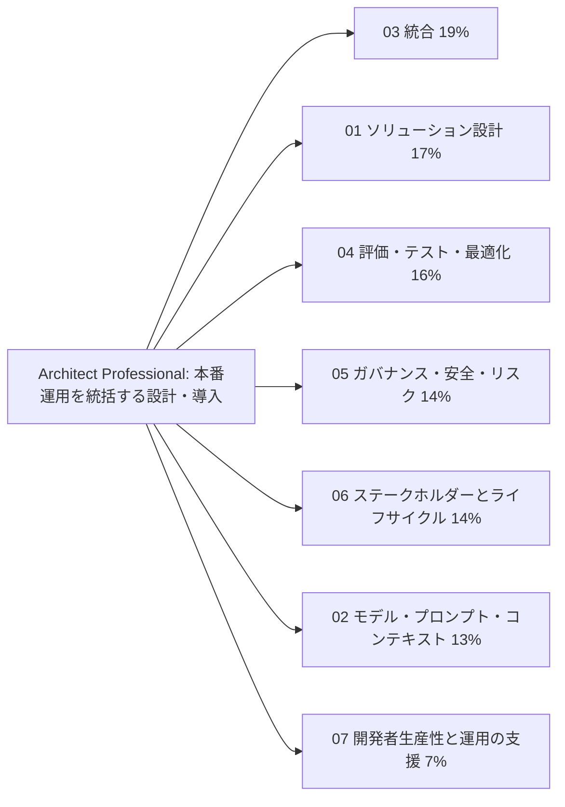
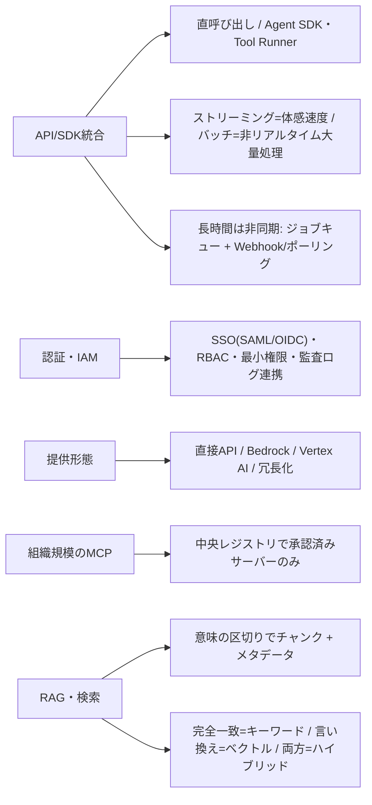
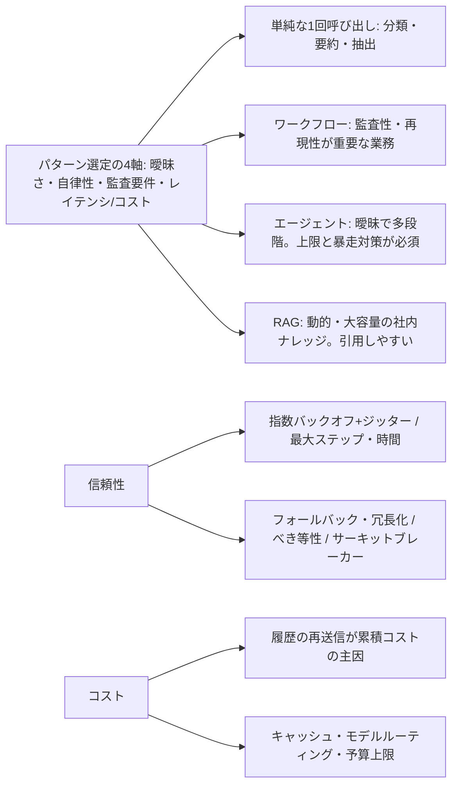
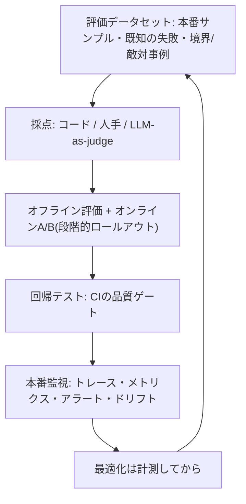
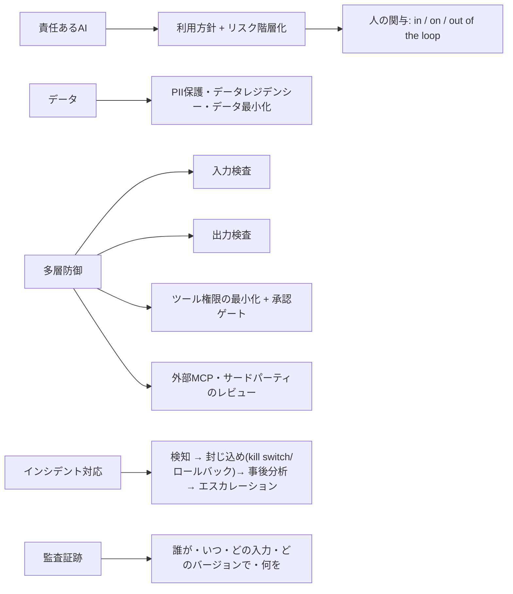
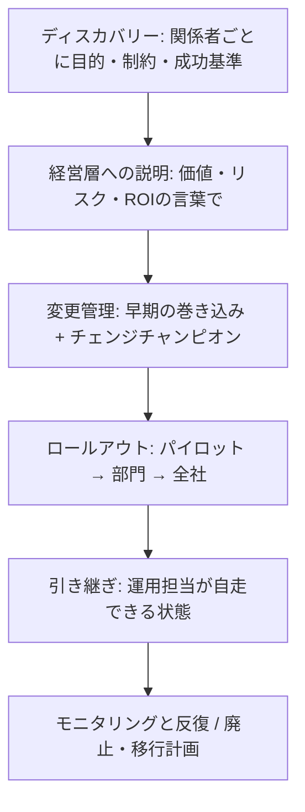
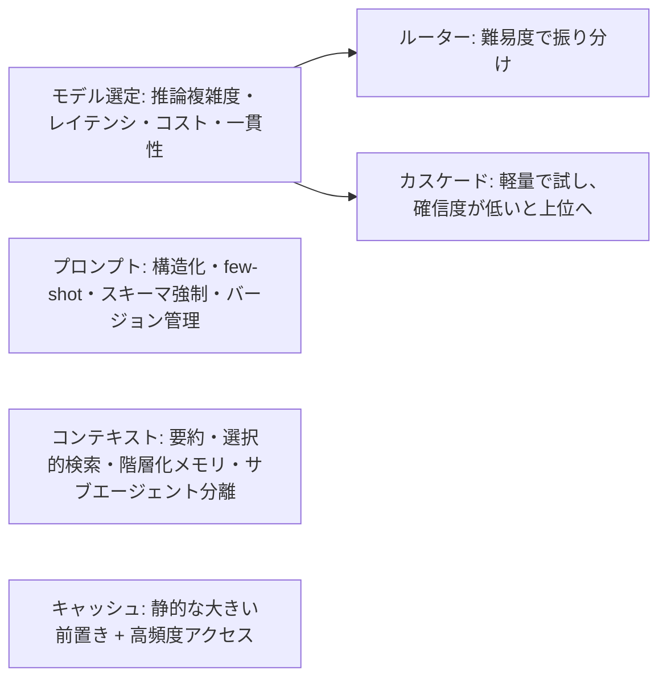
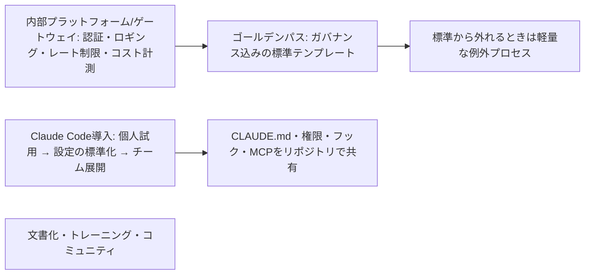

# Architect – Professional: 覚える内容の俯瞰図

7ドメインで問われる内容を、図(流れ・構造)と表(覚える項目・正答の型・よくある誤答)で整理したページです。
根拠は各ドメインの `topics/*/notes.md` と、練習問題(65問)の正答です。配点は 03(19%) → 01(17%) → 04(16%) → 05・06(14%) → 02(13%) → 07(7%) と分散が緩やかなので、全ドメインを広く押さえます。

## 全体像

全ドメインに共通する、正答になりやすい型は次のとおりです。

| 型 | 正答になる設計 |
|---|---|
| 最も単純で要件を満たすもの | 単純な1回呼び出し → ワークフロー → エージェント → マルチエージェント。複雑さは必要なときだけ上げる |
| リスクに応じて配分 | 全件を確認させず、不可逆・高リスクな操作だけ人の承認を置く。リスク階層化で承認・監視を厚くする |
| 共通化して仕組みで守る | 個別チームの自己責任にせず、ゲートウェイ・ゴールデンパス・承認済みレジストリなどに集約し、例外は軽量な手続きで |
| 測ってから決める | 最適化・モデル変更・展開は、評価データセットとメトリクスの計測に基づいて行う |
| 事前に決めておく | 成功基準、ロールバック、エスカレーションパス、廃止計画は、起きてからでなく事前に定義する |

---

## 03. 統合(19%、最大配点)

| 覚える項目 | 正答の型 | 誤答になりやすい例 |
|---|---|---|
| 各チームが個別にAPI利用 | 認証・ロギング・コスト計測・シークレット管理を共通化した社内ゲートウェイ経由に移行 | 自己申告に任せる / 準備なしで直接APIを禁止 |
| Bedrock併用の動機 | マルチプロバイダ冗長化で単一障害点を避け、既存のAWS IAM/ガバナンスとも統合できる | 直接APIはレート制限がない / すべてのモデルで常に安い |
| クラウド選定の検討事項 | 既存契約・データレジデンシー・IAM統合・リージョン・モデルの提供タイミング(直接APIの方が新モデルが早い傾向) | — |
| 組織規模のMCP | 中央でMCPサーバーの承認済みレジストリを整備し、提供元・権限スコープ・監査可能性を事前レビュー | 標準だから安全とみなして接続を許可 / 全社で禁止 / 事後報告のみ |
| MCPの配置 | ローカル(stdio)=個人環境 / リモート(HTTP)=組織共有。本番は中央ホスティング+アクセス制御 | — |
| 接続方式の選択 | 再利用・共有したい連携にはMCP。既存のAPIやCLIで足りる箇所は直接使う | MCPに統一 / 連携ごとに独自定義 |
| MCPで公開 | 複数アプリから共通に使うならMCPサーバーとして公開し、各クライアントから接続 | アプリごとに別実装 / 管理者認証情報を各アプリに埋め込み |
| 権限の落とし穴 | サービスアカウントで全ユーザーの操作を実行すると、ユーザーごとの認可が反映されず権限を超えた操作が可能になる | — |
| 認証と認可 | エージェントが誰の権限で動くか(ユーザーかサービスか)を明確にし、最小権限と操作ごとの認可確認 | — |
| 型番を取り逃す検索 | キーワード検索(完全一致)を組み合わせ、意味検索と併用するハイブリッド | ベクトル検索だけを改善 / 全文書をプロンプトに入れる |
| チャンキング | 見出しや段落など意味の区切りで分割し、前後に重なりを持たせ、出典・日付などのメタデータを付ける | 1文字ごと / 巨大な1チャンク / 全文投入 |
| 大規模文書の扱い | 必要になったときに検索・読み込みを行い、段階的にコンテキストを増やす(段階的ディスカバリー) | 上位文書だけ事前選択 / 要約版のみ / 入る範囲まで最初に入れる |
| 回答が古い | 文書の更新をインデックスに反映する仕組みを設け、日付などのメタデータで鮮度を扱う | 一度だけ作成して使い続ける / ユーザー報告後に手作業 |
| 下流との不整合 | 構造化出力の契約化+検証層(バリデーション・リトライ・人のレビューのフォールバック) | — |
| ツールの肥大 | 役割ごとに必要なツールだけに絞り、サブエージェントに分割。各ツールの説明に用途と使い分けを書く | ツールを追加し続ける |
| 運用規模の観測 | リクエストごとのトレースと、トークン数・遅延・エラー率のメトリクスを収集し、閾値でアラート | — |
| 非同期とイベント | 長時間タスクはジョブキュー+Webhook/ポーリング。イベント駆動(Kafka・SQS)で疎結合。レガシーにはアダプター層 | — |

## 01. ソリューション設計とアーキテクチャ(17%)

| 覚える項目 | 正答の型 | 誤答になりやすい例 |
|---|---|---|
| 判断が追跡可能な必要がある | 決定論的な制御フローのワークフロー型とし、金銭的影響のあるステップでだけ人の承認を挟む | ルールベースのみ / 自律ループに判断と承認まで委ねる / LLM-as-judgeで承認を自動化 |
| 手順が決まっていてほぼ同じ | コードで経路を定義したワークフロー(プロンプトチェイニング)で各ステップをClaudeが担当 | 自律的なマルチエージェント階層 / Claudeを使わない |
| ツールが増えて精度・遅延が悪化 | タスクごとに機能をサブエージェントへ分割し、オーケストレーターが委譲 | ツールをさらに追加 / 最上位ティアに固定 / 温度を上げる |
| 多数の資料を並列調査 | オーケストレーターが調査をサブエージェントに並列委譲し、各自が要約を返す | 1エージェントが1コンテキストに積む / 人が手作業 |
| FAQにマルチエージェント提案 | タスクが単純なら複雑さとコストの増加に見合わず、単一の呼び出しで十分 | 拡張性のため先行導入 / 少数に絞れば品質向上 |
| マルチエージェントの代償 | トークンコスト・レイテンシ・デバッグ難易度が増す。まず単一エージェント+ツール拡充で足りるか検討 | — |
| 状態の共有 | 明示的なメッセージ受け渡しで行い、暗黙の共有メモリに依存しない | — |
| 優先順位が衝突 | コストと応答時間のどちらを優先し、どこまで許容できるかを関係者と合意し、判断基準として文書化 | 一方を優先して後で調整 / 最高性能構成を先に設計 |
| エンドツーエンド設計 | 入力→処理→出力に加え、評価とフィードバックを収集し改善に戻すループを含める | 一方向の流れだけ |
| 探索的な調査の分解 | 発見に応じて次のサブタスクを生成する動的で適応的な分解 | 固定手順を順番に実行 |
| 知識が必要な社内QA | 検索を組み合わせた拡張LLM(RAG)で、取得した文書を渡して回答させる | LLMに暗記させる / ユーザーに文書を貼らせる |
| 遅延が緩くコスト最小化 | バッチ処理向けのAPI/割引を活用し、非同期でまとめて処理する | マルチエージェント並列 / ストリーミング / MCPサーバーを個別に起動 |
| 暴走コストの再発防止 | 最大ツール呼び出し回数・最大実行時間のガードレールと、コスト急増のアラート | 人手レビューに全面切り替え / キャッシュ無効化 / 軽量ティアに固定 |
| リトライ・信頼性 | 指数バックオフ+ジッター。LLM出力の再試行は結果が変わりうる。べき等キー(決済・メール)で二重実行を防ぐ。サーキットブレーカー | — |
| グレースフルデグラデーション | 別リージョン・別プロバイダへ切替、キャッシュ応答やルールベースへ降格 | — |
| コスト構造 | 入出力トークン×単価。マルチターンは履歴の再送信が主要因。TCOには監視・評価・人的レビューも含める | — |
| 容量設計 | RPM/TPMを前提にキューイング・スロットリング・バックプレッシャー。下流APIもボトルネック。ステートレス+外部ストア | — |
| 価値の柱 | 効率性・変革・生産性・コスト・パフォーマンスSLAのどれを重視するかで設計の優先順位が変わる | — |

## 04. 評価・テスト・最適化(16%)

| 覚える項目 | 正答の型 | 誤答になりやすい例 |
|---|---|---|
| 正解がない出力の評価 | 複数軸のルーブリック(正確性・網羅性・トーン)を設計し、LLM-as-judgeまたは人手評価で採点 | ルーブリックなしで目視 / 苦情件数のみ / exact match |
| 採点方式の特徴 | コード採点=決定論的な形式に高速・低コスト / 人手=最も信頼できるがスケールしない / LLM-as-judge=スケールするがrubric設計と判定者の検証が必要 | — |
| 評価データセット | 代表的なケース・エッジケース・過去の失敗例を含め、自動採点と人のレビューを組み合わせる | 有名な例だけ / 簡単なケースだけ / 1回の試行 |
| eval setの規模 | 数十件では不足。統計的に意味のある規模(数百件オーダー)を目指す | — |
| 変更の効果確認 | 同じ評価データセットで変更前後を比べ、A/Bテストで一部の利用者に先に展開 | 感覚で判断 / 展開後に苦情が出てから評価 / 複数の変更を一度に |
| オフラインとオンライン | オフラインeval=高速な反復 / オンラインA/B=離脱率などユーザー行動の指標。両方を組み合わせる | — |
| 段階的ロールアウト | 1% → 10% → 50% → 100%。異常ならすぐロールバック | — |
| 回帰テスト | 過去の失敗事例集を再実行。非決定的なので意味的一致や許容範囲で判定。CIの品質ゲートでマージをブロック。モデルバージョンはピン留め | 厳密な文字列一致 |
| 品質劣化の早期検知 | ロギングとオブザーバビリティで本番指標を継続監視し、しきい値でアラート | モデルを毎週入れ替える / 数か月に1回サンプル確認 / 利用者減少を待つ |
| モニタリングの内容 | トレース(各ステップ)、レイテンシのp50/p95/p99、トークン、コスト、成功率、エスカレーション率、フィードバック。ドリフト検知と継続的な人手レビュー | — |
| 検索品質の問題 | 回答が劣化したら、まず検索とインデックスの処理が関連のない/古いチャンクを返していないかを疑う | コンテキストウィンドウの縮小 / 温度 / モデル重みの変更 |
| 指標の定義 | 精度・レイテンシ・コスト・安全性など複数の指標を、トレードオフとして併せて追跡。各指標に閾値と責任者、逸脱時の対応手順 | — |
| コスト急増の最初の一歩 | トークン使用量とコストを機能・モデル・入出力・キャッシュ別に分析して、支出の大きい部分を特定 | 全面停止 / 先に最小モデルへ / 出力上限を下げる |
| 最適化の原則 | 計測してから行う。レイテンシ短縮のためのモデルダウングレードは、evalで品質への影響を検証してから本番適用 | 推測で最適化 |
| 問題の診断 | プロンプトの失敗・ハルシネーション・モデルの不適合を失敗例の分析で切り分け。RAGでは検索の関連性・鮮度も疑う | — |
| 失敗報告への対応 | 返品の失敗例を評価セットに追加し、原因(プロンプト・検索・モデル)を切り分けてから1つずつ改善し再評価 | 全体を書き換えて試行 / すぐ大きいモデルに |

## 05. ガバナンス・安全・リスク管理(14%)

| 覚える項目 | 正答の型 | 誤答になりやすい例 |
|---|---|---|
| 医療下書きの設計 | 影響度の高いユースケースとしてリスク階層化し、医師の最終確認を必須とするhuman-in-the-loop。規制要件も確認 | 人の関与なし(速度優先) / ガードレールなしで医師確認も省略 |
| 医療・金融の規制 | HIPAAなど適用される規制を要件に落とし込み、保管場所・アクセス制御・監査ログ・委託先管理を設計に組み込む | 運用開始後に法務が確認 / 匿名化すれば対象外 |
| 規制の例 | GDPR=個人データ保護 / HIPAA=医療情報 / FedRAMP=米国政府向けクラウド認可 | — |
| インシデント初動 | 問題のあるプロンプト/モデルバージョンをロールバックまたはkill switchで停止(封じ込め)し、事後分析(blameless)と、法務・広報等へのエスカレーション | 封じ込めせず調査だけ / 個人の責任追及 / 静観 |
| ガードレール | 入力の検査と出力の検査+ツール権限の最小化+影響の大きい操作の人の承認(多層防御) | 単一のガードレールに依存 |
| 外部MCPのリスク | サプライチェーンリスク。提供元・権限スコープ・監査可能性を事前レビュー | — |
| 人の確認の運用 | 金銭や契約に影響する不可逆な操作は人の承認を必須に。修正や差し戻しの結果を評価データやプロンプト改善に還元。全件確認は形骸化 | — |
| バイアスのある選考 | 属性別の結果を比較して継続的に検証し、最終判断は人が行い、異議申立ての経路も設ける | 属性を除外すれば公平 / 開示すれば検証不要 / 初回のみ検証 |
| ハルシネーション | 完全にはなくせない。根拠の提示、検証ステップ、重要な場面での人の確認を組み合わせて影響を抑える | 「わからないときは答えるな」で解決 / 利用者の責任とする |
| 審査の説明責任 | 基準に沿ったワークフローで処理し、判断の根拠を記録して、最終判断は人が確認 | モデル任せ / 結果だけ保存 |
| 回答の事後検証 | アクセス制御・保持期間・操作の監査ログ・リスクの高い回答への人の確認を組み合わせる | 無期限に誰でも閲覧 / ログを残さない |
| 監査ログの内容 | 誰が・いつ・どの入力で・どのツールを呼び、どんな出力が出たかを記録。個人情報はマスク。保持期間・アクセス権限・改ざん検知も設計 | — |
| レッドチーミング | 本番前にプロンプトインジェクション・有害誘導・情報引き出し・ジェイルブレイクを試す。更新のたびに継続し、結果をガードレールに還元 | — |
| データの扱い | PIIのマスキング/保存期間の最小化/アクセス制御。必要フィールドのみ取得(データ最小化)。API経由の顧客データは通常再学習に使われないが契約を確認 | — |

## 06. ステークホルダー対応とライフサイクル(14%)

| 覚える項目 | 正答の型 | 誤答になりやすい例 |
|---|---|---|
| 経営層への説明 | 評価結果による品質の根拠、想定コスト、リスク階層を、ビジネスへの影響の言葉で説明 | モデルの優位性・ベンチマーク中心 / 概算とデモ中心 / 競合の導入状況中心 |
| 部門間で意見が割れる | 関係者ごとに目的・制約・成功の基準を聞き取り、要件を文書化して合意 | 多数決 / 経営層の目的だけ / 試作先行 |
| 案の提案 | 各案の利点・欠点・コスト・リスクを示し、推奨案とその理由を相手の関心に合わせて説明 | 最低限だけ / 技術詳細を網羅 / 推奨を示さない |
| 現場の定着不安 | 設計の初期から対象部門を巻き込み、チェンジチャンピオンを置き、トレーニングと定着支援を展開計画に含める | トップの指示のみ / マニュアルとFAQのみ / 懸念部門を除外 |
| 期待値の調整 | 100%は保証できないと説明し、許容できる誤りの水準と、検知・訂正・人の確認の仕組みを顧客と合意 | 高い目標値を約束 / 契約で顧客責任にする / 導入を見送る |
| スコープの膨張 | 変更の影響(コスト・スケジュール・リスク)を整理して関係者に示し、合意を得て変更管理の手続きで計画を更新 | 一律に断る / 受け入れて事後報告 / テストを省略 |
| モデル廃止の予告 | 影響を受けるプロンプト・評価セットを棚卸しし、後継モデルでの回帰テストと段階的移行計画を早期に立てる | 何もしない / モデルをフォークして運用 / 全システム停止 |
| 運用への引き継ぎ | 設計の意図・前提・制約・運用手順・監視項目を文書化し、運用担当が自走できる状態にする | 資料一式を渡して質問対応のみ / 会議と議事録のみ |
| 実装ガイダンス | 構成・責務の分担・制約・判断の理由を図と文章で文書化して実装の基準を示す | 構成図だけ渡して詳細は任せる / 詳細設計どおりと指示 |
| 導入後の半年 | モニタリング結果と利用者のフィードバックから改善点を洗い出して反復 | 毎年作り直す / 完成とみなす / フィードバックを受けない |
| ロールアウト | パイロット→部門→全社の段階展開。進む前の成功基準を定量的に事前合意。ロールバック計画とコミュニケーション計画を用意 | 基準を事後に決める |
| 変更管理の原則 | ADKAR(認知→欲求→知識→能力→定着)の考え方。モデル更新のたびに繰り返される | — |
| ベンダー関係 | 契約・SLA(可用性、DPA、レート制限、容量)を設計に反映。モデルロードマップと廃止スケジュールを把握。サポートチャネルとフィードバック | — |
| 定量化 | 「AIが間違える可能性」ではなく、eval結果と影響範囲を示す。ROIには継続コスト(TCO)も含める | — |

## 02. モデル・プロンプト・コンテキストエンジニアリング(13%)

| 覚える項目 | 正答の型 | 誤答になりやすい例 |
|---|---|---|
| 分類+複雑なレビューが混在 | 難易度を判定し、定型的な分類は軽量モデルへ、複雑な契約書レビューは上位モデルへ振り分ける | 全件を軽量 / 全件を最上位 / ランダム選択 |
| 2種類の処理でモデル選び | 分類には高速・低コスト、契約書の分析には高い推論能力のモデルを使い分ける | 両方軽量 / 両方最高性能 / ランダム |
| ルーターとカスケード | ルーター=軽量モデルが難易度を判定してディスパッチ / カスケード=軽量で処理し、確信度が低いときだけ上位で再試行。ルーティング判断の監査ログも残す | — |
| モデルバージョン | ピン留めし、新モデルへは回帰テストを経て段階的(canary/blue-green)に切替 | — |
| 大量の静的文書+頻繁な質問 | プロンプトキャッシュを使い、静的な大きいドキュメントをプロンプト先頭に固定して配置 | 質問を毎回要約 / 出力上限を下げる / 文書を要約して短縮 |
| 長いポリシーと履歴 | 静的なシステムプロンプトとポリシーを動的な内容の前に置き、キャッシュを有効にする | ポリシーを切り詰める / few-shotに移す / 最小モデルに切り替える |
| キャッシュの経済性 | アクセス頻度がTTLより高いときに効く。書き込み・読み取り・非キャッシュ単価を分けて試算。低頻度では償却されない | — |
| 結論を急いで誤る | 思考の連鎖を使い、段階的に考えさせてから結論を出させる | ゼロショットで結論だけ / 温度を最大 / 出力を極端に短く |
| 複数製品の共通+固有指示 | 共通部分と固有部分をモジュール化し、プロダクトごとに組み合わせる。共通部分はバージョン管理 | 1つに条件分岐でまとめる / 製品ごとに全文を別管理 |
| 長時間エージェントの劣化 | ツール出力を絞り、古い履歴を要約し、重要な事実は別に保持 | 履歴をそのまま残す / 管理しない / 毎回ゼロから |
| 長い会話でルールが守られない | 重要なルールを構造の中で明確に区切り、会話の途中でも再掲し、出力を検証する仕組みを加える | ルールの量を2倍 / 特別な対策なし / モデルに任せる |
| プロンプト再利用 | プロンプトキャッシュ、モジュール型プロンプト、スキル(必要時のみ読み込む手順) | — |
| 温度の使い分け | 分類・抽出=低温度、創造的=高め。ただし温度だけで一貫性を担保せず、プロンプト構造で分散を抑える | — |
| コンテキストの考え方 | 「入るか」でなく「入れる価値があるか」。短期・長期・作業メモリの階層化。サブエージェントには必要最小限だけ渡す。Lost in the middle | — |
| 構造化出力 | スキーマ提示・構造化ツール呼び出しでパース失敗を減らす。few-shotは境界事例を含めて厳選 | — |

## 07. 開発者生産性と運用の支援(7%)

| 覚える項目 | 正答の型 | 誤答になりやすい例 |
|---|---|---|
| 開発環境の設定共有 | CLAUDE.md・権限設定・フック・MCP設定をリポジトリで共有し、チーム標準にする | メールで配布 / 各自の好みで設定 / 共通設定なし |
| 導入の順序 | 効果が大きくリスクの低い作業(コードレビュー、テスト生成など)から導入し、効果を測りながら広げる | 全社員に一斉導入 / 本番直結から / 導入しやすい部門を利用者数で評価 |
| デバッグ支援の入力 | エラーログ・再現手順・期待する挙動・関連するコードを具体的に与える | 「動かない」だけ / 全リポジトリを渡す / ログを伏せて推測だけ伝える |
| Claude Code 導入の権限 | 最小権限。本番環境への書き込み権限は慎重に。サンドボックス | — |
| 導入効果の測定 | コード生成量ではなく、レビュー通過率・バグ密度・開発サイクルタイムなどの生産性・品質指標 | — |
| ゴールデンパス | 推奨される標準的な作り方(認証・ロギング・評価フック込み)を用意。外れるときは理由を説明する軽量な例外プロセス。継続的に保守 | 一時停止や全面禁止 |
| プラットフォームチームの役割 | ゲートウェイは複数プロバイダ切替や監査ログを一箇所に集約。利用状況とコストを可視化するダッシュボード | — |
| ドキュメント | 機能一覧でなく意思決定ガイド(いつどのパターンを選ぶか)。動くサンプルとテンプレートを添える。FAQでセルフサービス化 | — |
| トレーニング | 使い方に加え、ガバナンスと評価の原則も教える。社内コミュニティ・オブ・プラクティスで知見共有 | — |
| 成功指標 | 利用者数だけでなく、ゴールデンパスの採用率、自己解決できた問い合わせの割合など自立度 | — |
