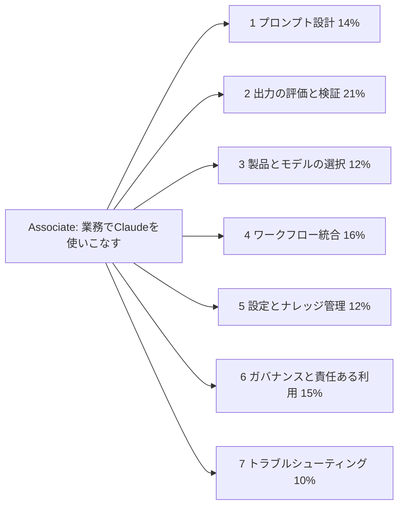
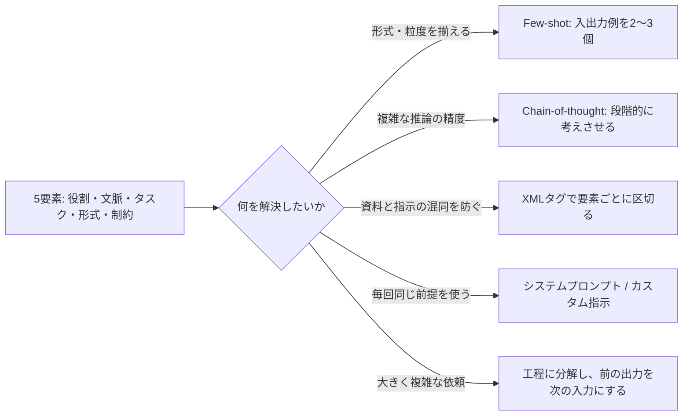
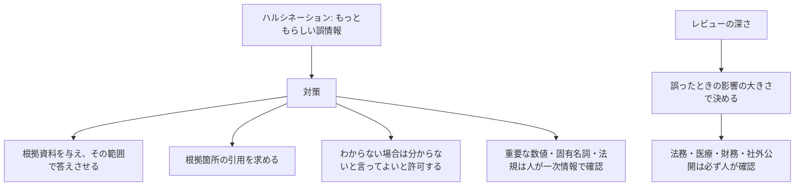
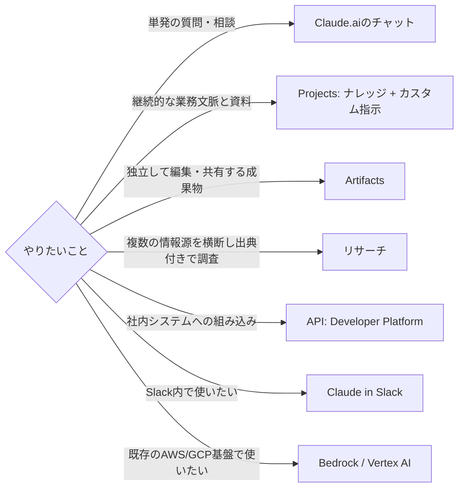
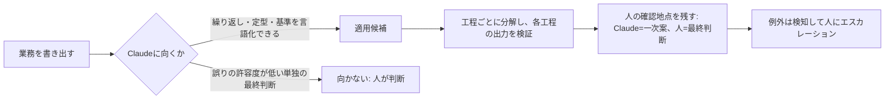
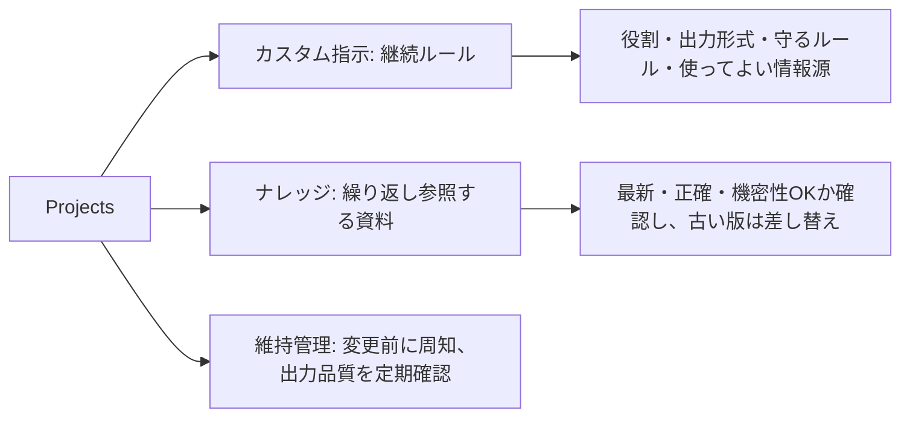
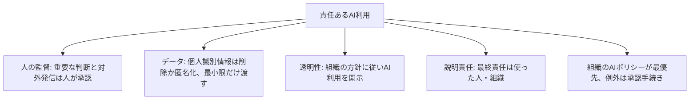
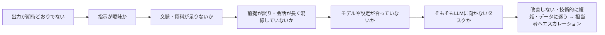

# Associate – Foundations: 覚える内容の俯瞰図

7ドメインで問われる内容を、図(流れ・構造)と表(覚える項目・正答の型・よくある誤答)で整理したページです。
根拠は各ドメインの `topics/*/notes.md` と、練習問題(62問)の正答です。配点は 2 → 4 → 6 → 1 → 3・5 → 7 の順に大きい。

## 全体像

どの問題にも通じる判断軸は次の3つです。

| 判断軸 | 正答の型 |
|---|---|
| 誤りの影響が大きいか | 大きいほど、人の検証・承認を厚くする。Claudeの単独判断にはしない |
| 情報は足りているか | 足りないなら、資料・文脈・基準を与える。強い口調や回数で解決しない |
| 小さく始められるか | 軽量モデル・1工程・1会議から試し、評価して広げる |

---

## 1. プロンプト設計とタスク実行(14%)

| 覚える項目 | 正答の型 | 誤答になりやすい例 |
|---|---|---|
| プロンプトの5要素 | 役割・文脈・タスク・出力形式・制約を明示する | 「良い感じに」「もっと良くして」とだけ伝える |
| Few-shot | 望ましい入出力例を2〜3個示す。例の一貫性が重要 | 書式ルールを長文で説明し直すだけ |
| CoT | 「ステップごとに考えてから結論を」と指示。途中の推論も検証できる | 出力形式を省いて自由に答えさせる |
| XMLタグ | `<document>` `<instructions>` で資料と指示を区別する | 全文を改行なしで一続きにして情報量を減らす |
| 拡張思考 | 複雑な推論にだけ使う。単純な要約ではコストと時間が増えるだけ | すべてのタスクで常に有効にする |
| タスク分解 | 抽出 → 優先度づけ → アクション案のように工程を分け、前の出力を次の依頼で使う | 1つの依頼に全工程を詰め込む |
| 反復的な改良 | 足りない点を具体的に伝える(「結論を冒頭に」「専門用語を減らす」) | 同じ依頼を文言を変えず再生成し続ける |
| 読み手への調整 | 読み手の属性・避けたい用語・望むトーンを伝えて依頼し直す | 出力をそのまま送り、質問が来てから対応する |
| 構造化された依頼 | 観点を見出しとして指定し、行数などの制約も付ける | 観点は後で人が整理するので指定しない |
| 分析 / 調査 / 下書き | 分析=観点と基準と根拠 / 調査=情報源の範囲と事実・推測の区別 / 下書き=対象者・トーン・長さ・構成 | — |
| ブレインストーミング | 量を先に出させ、評価と絞り込みは別の工程で基準を決めて行う | 発想と評価を1つの依頼で同時に行わせる |

## 2. 出力の評価と検証(21%、最大配点)

| 覚える項目 | 正答の型 | 誤答になりやすい例 |
|---|---|---|
| 評価の5軸 | 正確性・関連性・完全性・一貫性・有用性 | 出力の分量(文字数・トークン数)の多さを品質とみなす |
| 疑うべき箇所 | 具体的に見える詳細(条文番号・統計値・固有名詞)ほど疑って確認する | 自信ありげな文章なら正しいとみなす |
| 条文番号が怪しい概要 | 公式の条文と照合し、概要の趣旨が合っているかも確認してから共有 | 別の会話で再質問し一致すれば正確とみなす / 番号だけ削除する |
| 数値の食い違い | 元データと突き合わせて正しい値を確認し、他の数値にも同様の食い違いがないか点検する | Claudeにどちらが正しいか聞く / 注記だけ付けて提出する |
| 確信度 | Claudeに答えさせた確信度は、正確性の信頼できる指標にならない | 自己申告の確信度でレビューを省く |
| 自己チェック | 生成と評価を分けて依頼すると有効。ただし人の最終確認の代替にはならない | 自己レビューで人の確認を省く |
| 複数回生成 | 同じ依頼を複数回出して安定性を見る | — |
| バイアス | 属性情報を入力から除外し、評価基準を明示し、結果を人が抜き取り確認する | プロンプトに「公平に」と追記して様子を見るだけ |
| 知識の限界 | カットオフ以降・社内固有の情報は知らない。資料を与えるか外部ツールを併用 | — |
| 計算の検算 | 桁数の大きい計算や集計は誤りうるので別途検算する | — |
| 読み手別の編集 | 読み手ごとにトーン・専門用語・詳しさを指定して別版を作らせ、比べて調整 | 1つの版を全員に共通で使う |
| 比較表 | 比較の項目と評価の尺度を先に定義し、同じ基準で再作成させる | 基準が揃わない表のまま共有する |
| 出力形式の選択 | 再利用する長い成果物=アーティファクト / 短い説明=インライン / 機械処理=構造化データ | すべて画像にする |
| 検証の深さ | 経営判断に使う要約は、数値と主張を元資料と照合し人がレビュー | 構造化された文書は精度が高いので検証不要とする |
| 人が検証すべき場面 | 社外公開の数値を含む文書 / 法的拘束力のある契約条項案 | — |

## 3. 製品とモデルの選択(12%)

| モデル | 位置づけ | 向く業務 |
|---|---|---|
| Haiku | 最も高速・低コスト | 大量の定型処理、一次分類、リアルタイム応答 |
| Sonnet | 速度・コスト・能力のバランス | 日常業務の標準。まず試す選択肢 |
| Opus | 最高の推論能力 | 複雑な多段階分析、誤りの影響が大きく深い推論が必要な作業 |

| 覚える項目 | 正答の型 | 誤答になりやすい例 |
|---|---|---|
| 選定の基本 | 軽量モデルで試し、品質が足りなければ上位に上げる | 迷ったら常に最上位 / 上位ほど速く低コストと思い込む |
| 大量+難案件混在 | 軽量モデルで一次対応し、難しい案件は上位モデルか人に回す | 全件を最上位で処理 / 全件を軽量で処理し指摘後に修正 |
| 影響が大きく深い推論が必要 | Opusを選び、結果は人が検証する | コスト優先で最軽量を使い、確認せず採用 |
| 継続案件の文脈 | プロジェクトを作り、資料はナレッジ、ルールはカスタム指示に設定 | 毎回新しいチャットで背景を貼り直す |
| 会話が長くなったら | やり直す(話題が変わった・混線) / 要約して引き継ぐ(決定事項・前提・残課題) / 保持する(継続作業で有効なとき) | 序盤を一字一句貼り直す |
| メモリ | 保持される内容を確認し、不要・不正確・機密な内容が残らないよう管理する | — |

## 4. ワークフロー統合とソリューション設計(16%)

| 覚える項目 | 正答の型 | 誤答になりやすい例 |
|---|---|---|
| 向く業務 | 繰り返す、手順がある程度決まっている、作業時間の多くが整理や下書き | 誤りの許容度が極めて低い単独の安全判断を任せる |
| 役割分担 | Claudeは一次分類・下書き、最終判断は人 | 緊急度判定と返信送付をClaudeに完全自動で任せる |
| 工程分解 | 工程ごとに分解し、各工程の出力を検証してから次へ | 検証は最終成果物だけ / 全工程を1プロンプトにまとめる |
| 統合パターン | 単発 / Projects型 / API統合型(出力検証が必須) / チャットツール統合型 | — |
| 統合設計の必須項目 | 機密情報の扱い、結果の検証、失敗時のフォールバック(人による代替) | — |
| 支払いに直結する確認 | Claudeが一次確認し、承認は人が行う。承認者には確認結果と根拠箇所を併せて提示 | 異常なしの請求書を自動で支払いに回す |
| 一次回答の自動化 | Claudeが回答案を作り、人の確認後に送付、難しい案件は担当者へ引き継ぐ | 確認なしで即送信し、問題があれば後で訂正 |
| 要件の洗い出し | 概要を伝えてClaudeに質問させ、抜けている要件・前提を洗い出す | 最初に詳細な実装を作らせる |
| 導入の進め方 | 現状の手順と課題を聞き取り、1つの会議で試して評価・改良する | 全部署に一斉導入 / 効果を保証して合意を得る |
| 効果の報告 | 確認時間込みの正味の効果、対象範囲、誤りへの対策、段階的な拡大案 | 確認工数を除外し短縮率のみ報告 / 全社データが揃うまで保留 |
| リスクの説明 | 主なリスク(ハルシネーション、機密情報)と対策(検証・人の確認・利用範囲の限定)をセットで伝える | リスクはIT部門に一任し効果だけ説明 |
| 技術的に複雑な実装 | 要件を整理し、デベロッパー/アーキテクトに相談する | 経験がないまま独力で始める / 理由なく断る |

## 5. 設定とナレッジ管理(12%)

| 覚える項目 | 正答の型 | 誤答になりやすい例 |
|---|---|---|
| 指示と資料の違い | カスタム指示=全体に適用される継続的なルール / ナレッジ=参照する資料 | 同じ機能の別名 / 認証情報の管理機能 |
| 指示の書き方 | 役割、出力形式、ルール、使ってよい情報源を簡潔に、矛盾なく書く | あらゆる場面のルールを網羅して長く書く / 個別タスクの指示まで全部入れる |
| 矛盾した指示 | 矛盾を解消し、場面ごとの方針(要約は簡潔に、分析は詳しく)を明記 | ルールを足してどちらを優先するかはモデル任せ |
| ナレッジの更新 | 旧版を削除して新版に差し替え / 版数・更新日を明記 / 担当者と頻度を決めて棚卸し | — |
| コネクタ | 接続アカウントの権限を必要最小限に / 接続データがデータポリシーに適合するか確認 | — |
| 指示を変えるとき | 全員に影響するので事前に周知し、出力を確認して調整する | 周知せずすぐ書き換える |
| 機密資料の登録 | 組織のデータポリシーと契約上の秘密保持条項を確認し、許可される場合に限り共有範囲を絞って登録 | 社内の人間だけなので確認なしで登録 |

## 6. ガバナンス・リスク・責任ある利用(15%)

| 覚える項目 | 正答の型 | 誤答になりやすい例 |
|---|---|---|
| Constitutional AI | モデル自身が原則(憲法)に照らして自らの出力を評価・改善するよう訓練するアプローチ | 利用規約の別名 / 外部の法令監査 / Enterprise専用機能 |
| 3つの性質 | 有用・正直・無害(Helpful, Honest, Harmless) | — |
| データの学習利用 | プランごとに学習利用ポリシーが異なりうる。契約内容を確認する | — |
| 個人データを含む分析 | 識別できる列を削除/匿名化(ID化)し、ポリシーで許可された環境にアップロード | 社内利用なので対象外とみなす / 分析を断念 |
| 「保持しないよう頼む」 | それだけではポリシー要件を満たさない | 分析後に会話履歴を削除すれば足りる |
| 例外が必要なとき | 理由と扱うデータを整理し承認手続きを案内、承認までは許可されたツールで対応 | 期間を限って黙認 / 機密を入れない条件で個人判断の利用を認める |
| 医療相談の自動返信 | 一般的な情報提供と受診案内に限り自動返信、個別の診断や助言は人が確認 | 免責を付ければ全面自動 / 忙しい時間帯は承認を省略 |
| AIで作った成果物 | 組織の方針に従って開示し、正確性や権利への配慮は公開する人が責任を負う | 責任はAIの提供元にある / 顧客には隠す |
| 評価コメントの要約 | ポリシーで許可されたツールと範囲を確認し、個人が特定できる情報を除いて要約 | 部署単位ならポリシー確認を省く / 個人アカウントで要約 |
| 契約書レビュー | 論点の洗い出しの補助には使えるが、法的な判断は専門家が確認する | Claudeに任せて締結手続きまで進める / 洗い出しにも使わない |
| 覚えておく原則 | 人の監督・最小限の共有・透明性・説明責任。影響度に応じて検証を厚くする | — |

## 7. トラブルシューティングと最適化(10%)

| 覚える項目 | 正答の型 | 誤答になりやすい例 |
|---|---|---|
| 最初に見直す点 | 依頼文に目的・読み手・出力形式・成功基準があるか | 上位モデルへ切り替え / 参考資料をむやみに増やす |
| 切り分けの順序 | 指示の曖昧さ、資料の不足、会話の長さによる混線を順に疑い、具体的に直す | 同じプロンプトを何度も繰り返す / 故障と決めつける |
| 改善の基本 | 変更は1つずつ。Few-shot追加、タスク分解、モデル変更を使い分ける | 一度に複数箇所を変える |
| 手戻り対策 | プロンプトのテンプレート化、共通ルールをプロジェクトにまとめる | 前回の出力を確認せず使い回す |
| 結果が安定しない(税務など) | Claudeは根拠条文や計算過程の整理に限定、判断は専門家が行う | 修正指示を詳細にして安定するまで繰り返す |
| 毎回数値が変わる集計 | 定義と手順を明示し、重要な数値は表計算など再現性のある手段で算出して照合 | 3回実行して最も多い数値を採用 |
| エスカレーション | 繰り返す誤り、システム連携の技術エラー、不確実性の表明、高リスクは人/技術チームへ | — |
