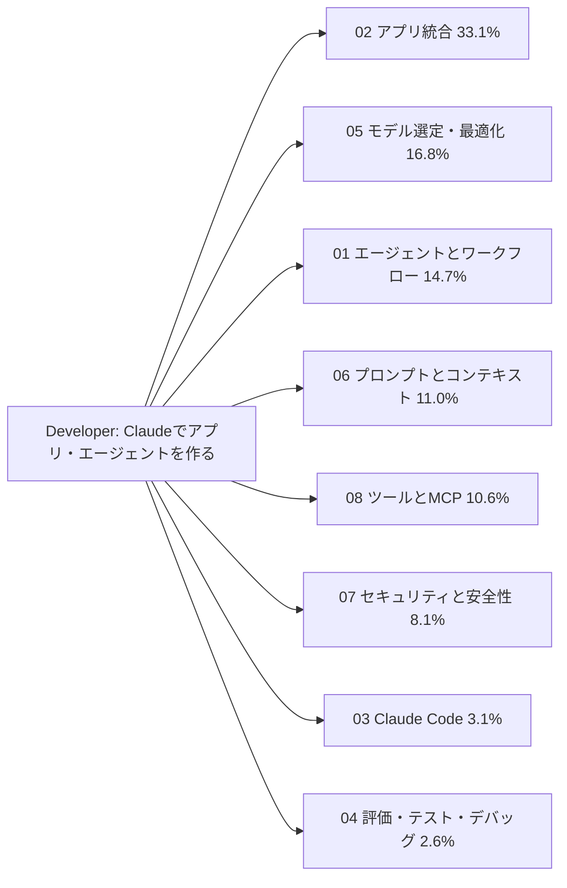
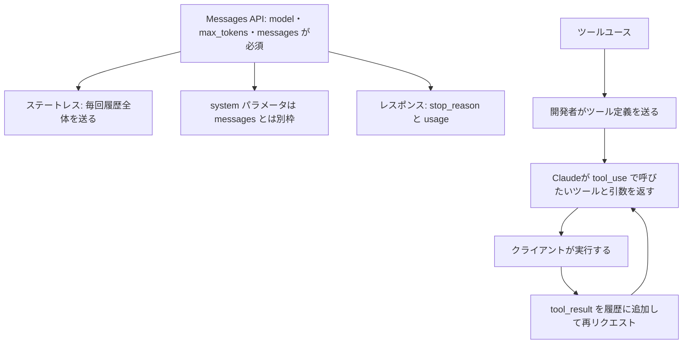
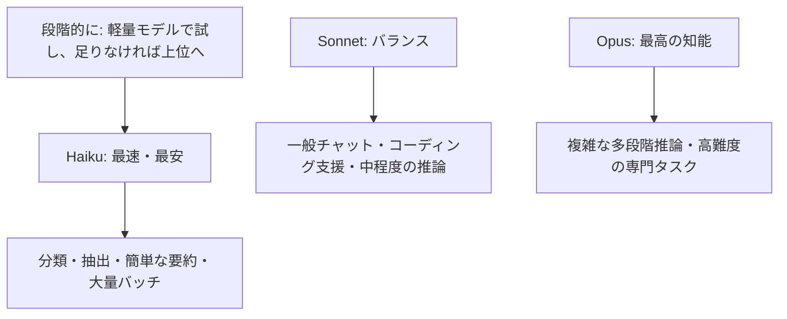
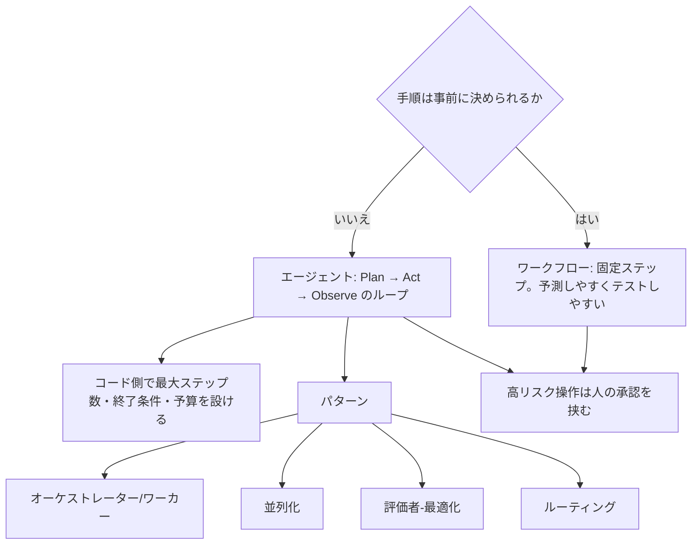
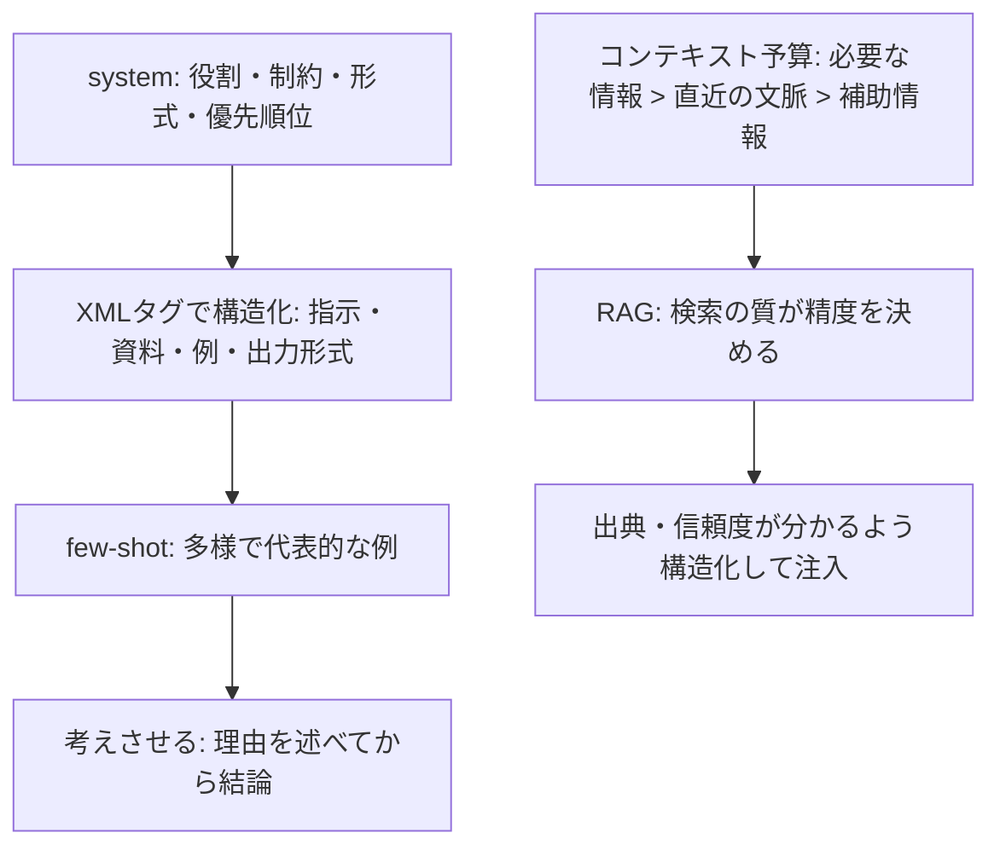
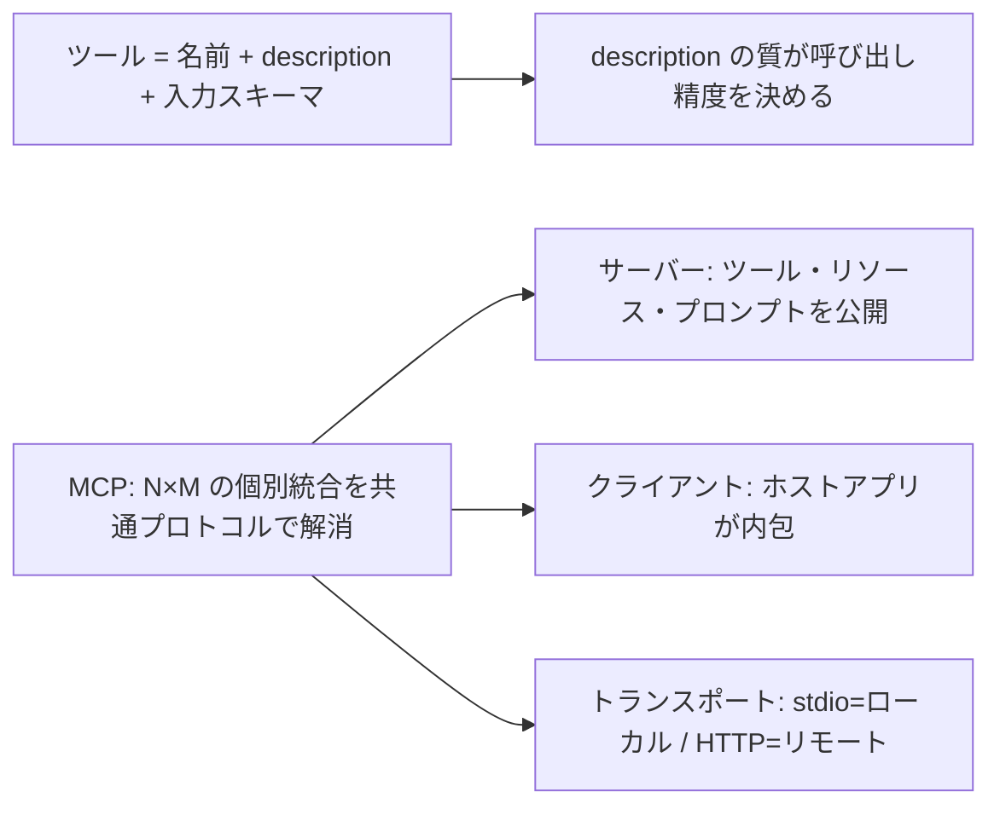
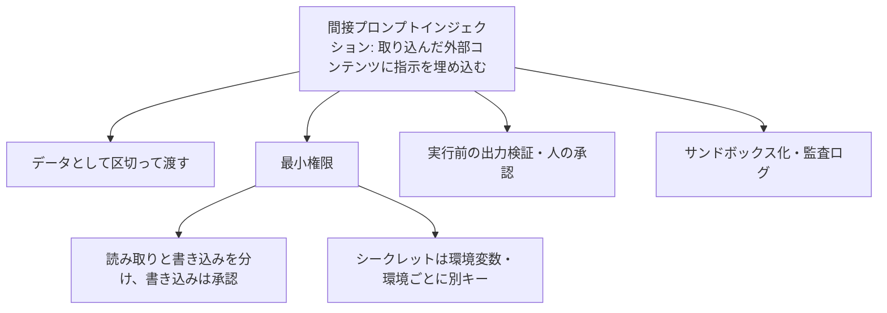
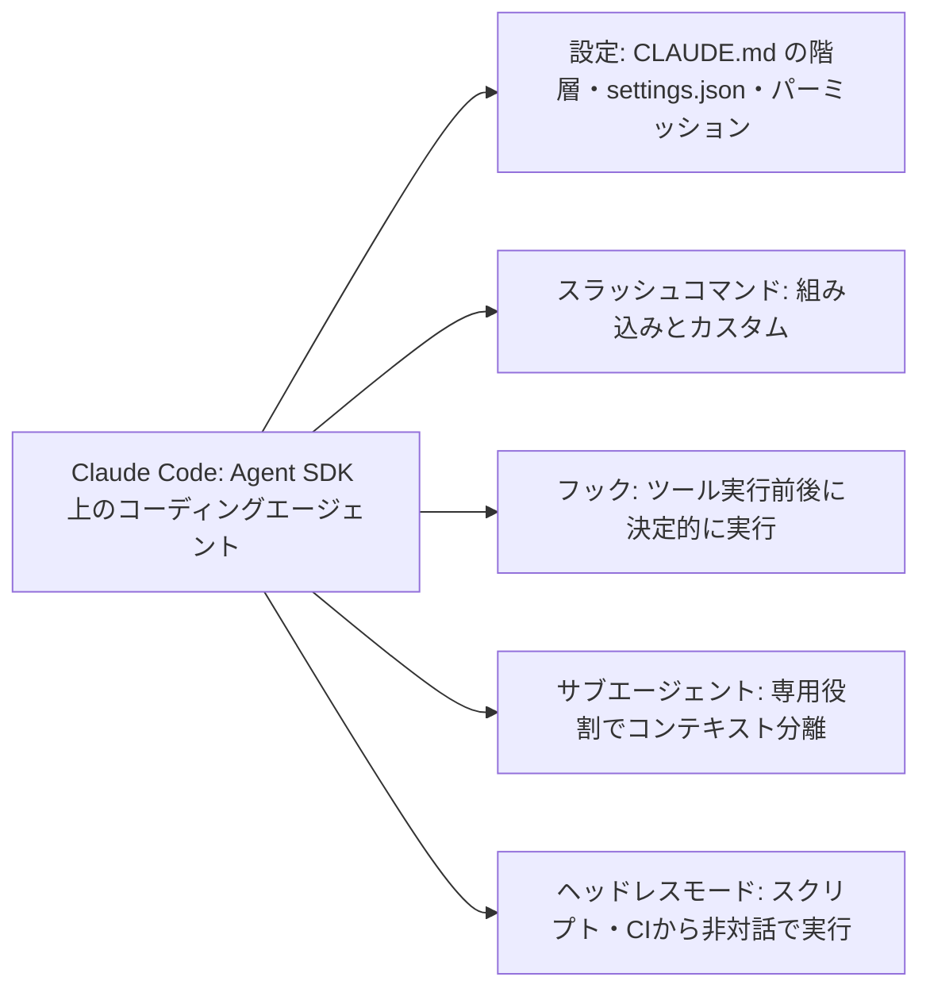
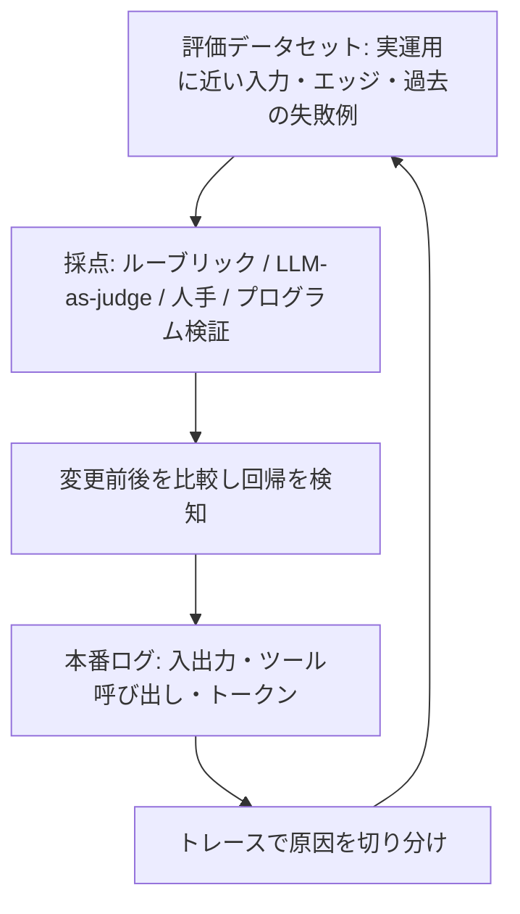

# Developer – Foundations: 覚える内容の俯瞰図

8ドメインで問われる内容を、図(流れ・構造)と表(覚える項目・正答の型・よくある誤答)で整理したページです。
根拠は各ドメインの `topics/*/notes.md` と、練習問題(59問)の正答です。配点は 02 が 33.1% と突出して大きいので、02 → 05 → 01 → 06 → 08 → 07 の順に厚く覚えます。

## 全体像

全ドメインに共通する設計の型は次のとおりです。

| 設計の型 | 内容 |
|---|---|
| まず単純に | 単発プロンプト → ワークフロー → エージェントの順に、必要なときだけ複雑さを上げる |
| 確実に守らせたい処理は決定的に | 「毎回〜して」はプロンプトのお願いではなく、フックやコード側の制御で実現する |
| 外部のものは信用しない | ツール結果・ユーザー入力・検索結果は「データ」。モデル出力もスキーマ検証してから使う |
| 変える前に評価する | モデル・プロンプトを変えるときは評価データセットで前後を比較する |

---

## 02. アプリケーションと統合(33.1%)

| 覚える項目 | 正答の型 | 誤答になりやすい例 |
|---|---|---|
| 会話の継続 | 会話履歴全体(ユーザー発言とAssistant応答)を `messages` 配列に入れて毎回送る | サーバー側がセッションを保持する / `session_id` を付ける / 1ターン目を `system` に入れる |
| stop_reason | `end_turn` `max_tokens` `stop_sequence` `tool_use`。なぜ生成が終わったかを示す | — |
| `max_tokens` で終了 | 出力が途中で切れている可能性。上限を引き上げるか続きを生成させ、切れた出力をそのまま使わない | 正常終了とみなす / temperature を下げて再実行 |
| tool_result の返し方 | `tool_use` を含む直前のassistantメッセージを履歴に残し、対応する `tool_use_id` の `tool_result` ブロックを **user** メッセージで送る | assistantロールで返す / `system` に追加 / `tool_use` を履歴から削除 |
| 構造化出力 | スキーマを持つツールを1つ定義し、強制的に呼ばせて構造化データを得る | `max_tokens` を小さくする / 「JSONで」と丁寧に頼むだけ |
| ストリーミング | 体感の待ち時間を短くし、長い出力のタイムアウトを避ける。SSEで逐次受信 | バッチAPIにする |
| バッチAPI | 結果が翌朝まででよく、コストを抑えたい処理に最適。非同期で約50%安。`custom_id` で結果を対応づける | 同期APIを大量並列 / ストリーミング |
| プロンプトキャッシュが効く場面 | 同一の長いシステムプロンプトとツール定義で多数のリクエスト、長い文書の使い回し、エージェントループ | 毎回内容が違う単発質問 / 二度と同じプロンプトを送らないバッチ |
| キャッシュの仕組み | プロンプト先頭から連続して一致する範囲に効く。途中が変わるとそれ以降は再利用されない。有効期限あり | 意味が同じなら再利用 / 永続的 / システムプロンプトだけが対象 |
| キャッシュ向けの構成 | 変わらない部分(システムプロンプト・ツール定義)を先頭にまとめ、ユーザーごとに変わる内容はキャッシュ対象の後ろ | ユーザー発言を先頭に置く |
| レート制限(429) | 指数バックオフ+ジッターで再試行し、上限回数で失敗として通知 | 固定間隔で無限に再試行 / 並列度を上げて再送 |
| エラーの分け方 | 一過性(429・5xx)は上限付きで再試行。再試行しても直らない入力エラー(4xx)は原因を直す | — |
| SDK | 型安全にMessages APIを呼べる。リトライ・タイムアウト・ストリーミングを吸収。キーは環境変数で渡す | キーをコードに直書き |
| Claude Agent SDK | 計画→実行→観察のエージェントアプリを作る土台。Claude Code自体もこの上に構築 | — |
| 画像入力 | Messages API のコンテンツブロックとして、テキストと一緒に送る | 別APIで文字起こししてから送る |
| 要件の確認 | 実装前に機能要件と、遅延・スループット・可用性のインフラ要件を確認し、合意する | 仕様を想像で決める |
| セッションの扱い | 話題が変わるときは新しいセッションに切り替え、必要な情報だけ引き継ぐ | 全履歴を毎回足す |
| 構成管理 | CLAUDE.md・`settings.json`・プロンプトをバージョン管理。モデルは日付つきIDで固定 | 最新を指す別名 |
| プロンプトの管理 | コードと同様にバージョン管理し、評価してからデプロイ | メールで共有 / 管理画面で直接書き換え |
| 配布する規約 | ユーザーレベルの指示は共有されない。リポジトリのプロジェクトレベル CLAUDE.md に置く | 各自の `~/.claude` に手作業でコピー |

## 05. モデル選定と最適化(16.8%)

| 覚える項目 | 正答の型 | 誤答になりやすい例 |
|---|---|---|
| 分類の大量処理 | まずHaikuで精度を検証し、不十分なら上位を検討する | 最初から最上位 / 検証を省く |
| 軽量か中位か迷う | 実運用に近い評価データセットで精度・遅延・コストを比べ、要件を満たす最も小さいモデルを選ぶ | ベンチマーク順位 / 数件を見比べる / 念のため中位 |
| 拡張思考 | 複雑な推論の精度が上がるが、コストとレイテンシが増える。難易度に応じて使い分ける | トークン消費は増えないので常時オン |
| リアルタイム応答 | 高速なモデルを選び、拡張思考は使わない | 常に最大の拡張思考 / バッチAPI |
| 精度最優先の推論 | 高い推論能力のモデル+拡張思考とエフォートレベルを目的に応じて設定 | 最小モデルで温度を上げる |
| 質問が混在 | 通常の質問は高速モデル、複雑な推論が必要なものだけ高性能モデル+拡張思考 | 全件に最高性能+最大の拡張思考 |
| コストの急増 | 入力・出力・キャッシュ別のトークン使用量を追跡し、消費箇所を把握する | 利用を全面停止 / 先にモデルを最小へ |
| コスト最適化の手段 | モデル選定、プロンプトキャッシュ、出力トークン制御、バッチ処理、プロンプトの簡潔化 | — |
| レイテンシ改善 | ストリーミング(体感)、出力トークン削減、並列実行、軽量モデル。総生成時間は短くならない点に注意 | — |
| 出力非決定性 | モデルは次のトークンを確率的にサンプリングするため、同じ入力でも出力がわずかに変わる | APIの不具合 / 前回の記憶 |
| モデルの移行 | リリース間で動作が変わりうる。評価セットで出力を比較してから切り替える。日付つきモデルIDで固定 | 評価せず切り替え / 全面書き換え |
| コンテキスト管理 | 古い履歴の要約・圧縮、不要なツール結果の切り捨て、必要な情報だけ検索して注入、外部ストレージに退避 | — |

## 01. エージェントとワークフロー(14.7%)

| 覚える項目 | 正答の型 | 誤答になりやすい例 |
|---|---|---|
| 手順が固定的 | 固定ステップのワークフローで十分。エージェントは不要 | 将来の拡張に備えて必ずエージェントループ / サブエージェントを5つ以上並列 |
| 手順が事前に決まらない | モデルがツール結果を見て次の行動を決めるループを組み、上限と終了条件をコードで設ける | 全分岐をコードで列挙 / 一度に全工程を計画して変更せず実行 |
| 範囲が広く分解して委譲 | オーケストレーター/サブエージェント(orchestrator-worker)パターン | — |
| 4つのパターン | 単一エージェント / orchestrator-worker / 並列化 / 評価者-最適化 / ルーティング(入力を分類して専門処理へ振り分け) | — |
| 並列調査 | コーディネーターがサブエージェントに委譲し、各自が要約した結果を返す | サブエージェント同士が直接通信 / 1エージェントが全部を1コンテキストに積む |
| 破壊的な操作を確実に止める | ツール呼び出し前のフックでブロックする | プロンプトで禁止 / 宣言させる |
| コンテキスト肥大化 | ツール出力を刈り込み、コンパクションし、冗長な探索はサブエージェントに分離 | そのまま続けさせる / 毎回全履歴を繰り返す |
| 長時間処理の再開 | 進捗と中間成果物をファイルやDBに保存し、再開時に読み込む | コンテキストを大きく取って保持 / 毎回最初からやり直し |
| 粒度 | 分解が細かすぎるとオーバーヘッド増、粗すぎるとコンテキスト肥大。各ステップには必要最小限の情報を渡す | — |
| フレームワーク | Claude Agent SDK、Strands、LangGraph、PydanticAIなどの抽象化フレームワークがある | — |

## 06. プロンプトとコンテキストエンジニアリング(11.0%)

| 覚える項目 | 正答の型 | 誤答になりやすい例 |
|---|---|---|
| 区切り方 | XMLタグ(`<instructions>` `<document>` など)でセクションごとに区切る | JSONのキー名だけで区別させる / 大文字や感嘆符で強調 |
| 形式がそろわない | 望ましい出力の例を数個示す(マルチショット) | 指示を長くする / 出力形式の指定を削除 / 温度を最大 |
| 具体的な指示 | 「簡潔に」より「3文以内で」のように検証可能に書く | — |
| few-shot の例 | 多様性と代表性を意識。数を増やすとトークンコストも増える。悪い例は悪い例と明示 | — |
| RAGの注意 | 検索の質が低いと無関係な情報がノイズになる。出典・信頼度が分かるよう構造化すると情報源を区別しやすい | 関連情報を大量に注入すれば良い |
| 出力の扱い | 構造化出力の仕組みやスキーマで形式を強制し、受け取る側でもスキーマ検証と防御的なパースを行う | 自信に満ちた出力を鵜呑み |
| コンテキスト整理 | 不要な中間生成物やツール結果を切り捨て、古い履歴を定期的に要約・圧縮 | — |
| 出力の誤情報対策 | 根拠となる情報源を併記させ、重要な内容は原文との照合や人の確認を通す | 語尾を「かもしれません」に統一 / 固定の注意書きのみ |

## 08. ツールとMCP(10.6%)

| 覚える項目 | 正答の型 | 誤答になりやすい例 |
|---|---|---|
| ツールを選び間違える | 説明に用途・入力・他ツールとの違い・使う場面と使わない場面を具体的に書く | 名前だけで区別 / 優先指示を一文足す / リトライを足す |
| MCPの目的 | LLMアプリと外部のデータソース・ツールの接続を標準化し、N×Mの個別統合を解消する | プロンプトキャッシュの実装 / 追加学習の手法 |
| ツール / リソース / プロンプト | ツール=実行可能なアクション / リソース=読み取り可能なデータ / プロンプト=再利用できるテンプレート | — |
| 共通で使いたい | MCPサーバーとして実装し、各クライアントから接続する | アプリごとに別々に実装 / 認証情報の直埋め込み |
| 実行場所 | クライアント側ツールは自分のアプリが実行して結果を返す。サーバー側ツールはAnthropic側で実行 | Claudeがインターネットに直接アクセス |
| 組み込み/カスタム/スキル/MCP | 組み込み=汎用 / カスタム=自社ロジック / スキル=手順と知識を必要なときだけ読み込む / MCP=外部を標準的に共有 | 常時システムプロンプトに載せる |
| サーバー実装の要点 | ツールの粒度、認証、入力バリデーション(サーバー側でも行う) | — |
| クライアント設定 | stdioは起動コマンド、HTTPはURLと認証を登録。プロジェクト単位/ユーザー単位で分離。外部サーバーも権限制御の対象 | — |
| ツール数 | 多すぎると選択精度が下がるため、タスクに必要なものに絞る | — |

## 07. セキュリティと安全性(8.1%)

| 覚える項目 | 正答の型 | 誤答になりやすい例 |
|---|---|---|
| 攻撃の呼び名 | Webページ等に「無視して〜せよ」が仕込まれる攻撃=間接プロンプトインジェクション | レート制限超過 / コンテキスト溢れ / キャッシュ失効 |
| 入力に指示のような文 | 入力は指示ではなくデータとして区切って渡し、過大な権限を持たせず、出力も検証する | 特定語句の削除 / 要約すれば安全 / 文字数制限 |
| 取り込んだページの指示 | データとして区切り、要約タスクにはメール送信ツールを付けず、必要なら送信前に人が承認 | 「ページ内の指示に従うな」と書けば十分 / ブロックリスト |
| 最小権限 | 必要な最小限のツールとスコープだけ与える。取り消しの難しい操作は人の承認を挟む | — |
| 権限の設計 | 役割に必要な最小限の権限+書き込み・外部送信ツールには実行前の承認 | — |
| 顧客リスト転送など | 権限の大きい操作はエージェントから外すか、人の承認を必須にする | — |
| キーの管理 | 環境ごとに別のキーを使い、コードに直書きせず環境変数で渡す。リポジトリにコミットしない | 1つのキーを共有 / チャットで共有 |
| PIIとログ | 必要最小限の情報だけ扱い、ログのマスキングとアクセス制御で漏えいを防ぐ | 全データをそのまま保存 / 全員が閲覧 |
| クラウド統制下で使う | 契約済みクラウド(Bedrock・Vertex AI等)経由で利用し、既存のネットワーク・権限・監査の統制を適用 | 直接APIのみ / プロンプトを暗号化して送る |
| 考え方 | 100%の防止は困難。多層防御(最小権限・検証・監査ログ)で被害を限定する | — |

## 03. Claude Code(3.1%)

| 覚える項目 | 正答の型 | 誤答になりやすい例 |
|---|---|---|
| 編集後にリンタを必ず実行 | フックを使い、ツール実行後にリンタが自動実行されるよう設定 | プロンプトでお願いするだけ / 毎回手動 |
| パイプラインを人の入力なしで進める | ヘッドレス(非対話)モードで実行し、結果を出力として受け取る | 対話モードで毎回承認 |
| CLAUDE.md | ユーザー・プロジェクト・ディレクトリの階層。チーム共有はプロジェクトレベルに置く | — |
| カスタムコマンド | よく使うプロンプトをテンプレート化してチームで標準化 | — |
| MCP連携 | プロジェクト単位とユーザー単位で設定を分離 | — |

## 04. 評価・テスト・デバッグ(2.6%)

| 覚える項目 | 正答の型 | 誤答になりやすい例 |
|---|---|---|
| 回帰の検知 | 実運用に近い入力と過去の失敗例を含む評価データセットで、変更前後の出力を体系的に比較 | LLMの出力は常に同じ / リリース後の報告まで待つ / 目視1〜2件 |
| 出力がおかしい原因 | トレースを確認し、入力・ツール結果・モデル出力のどこでずれたかを特定する | プロンプトをランダムに書き換える / すぐ上位モデルへ |
| 評価方法の使い分け | ルーブリック=基準を明文化 / LLM-as-judge=スケールしやすいが判定プロンプトの検証が必要 / 人手=高リスクと判定者の検証 / スキーマ適合などは自動検査 | — |
| ツール呼び出しの失敗パターン | ツール誤選択、引数の誤り、結果の解釈ミス、ループ暴走 | — |
| ログの目的 | 障害の原因調査と、評価データセットへのフィードバック | — |
