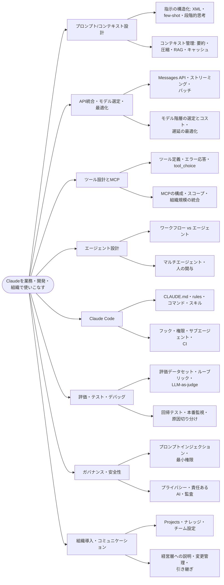
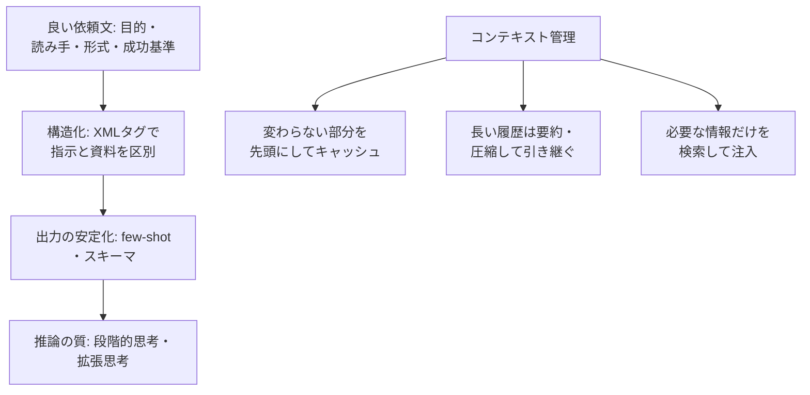
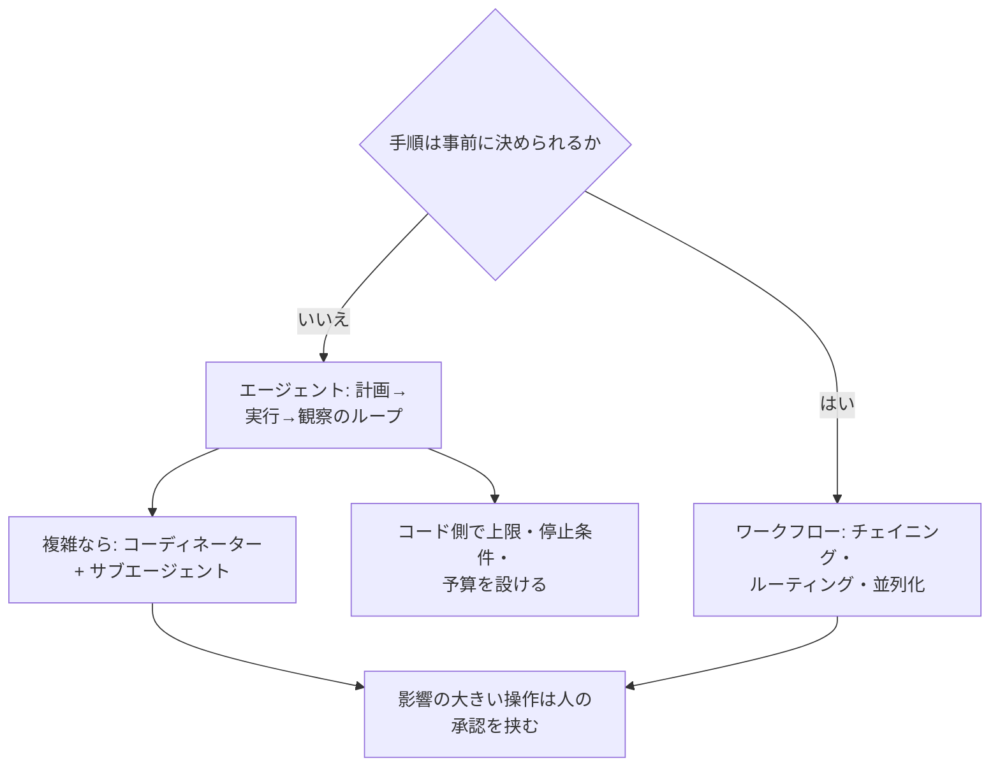
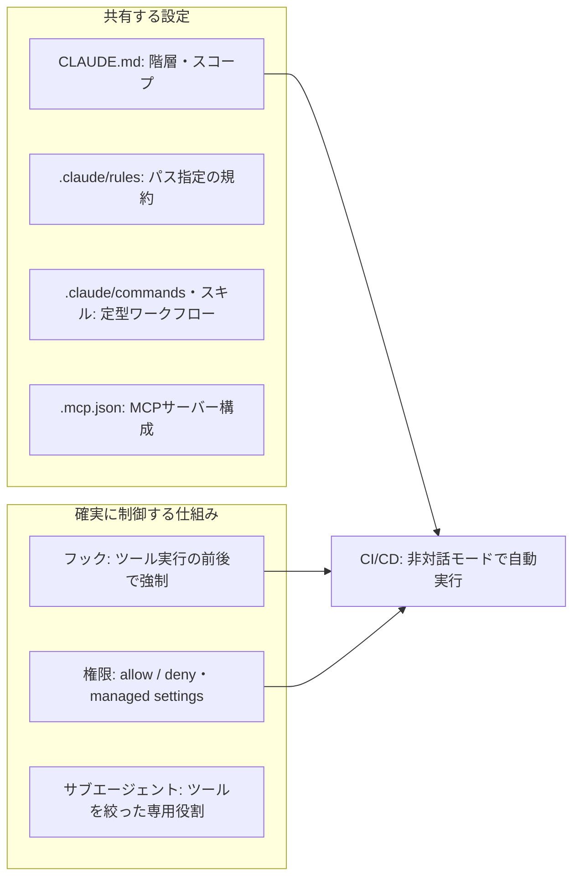
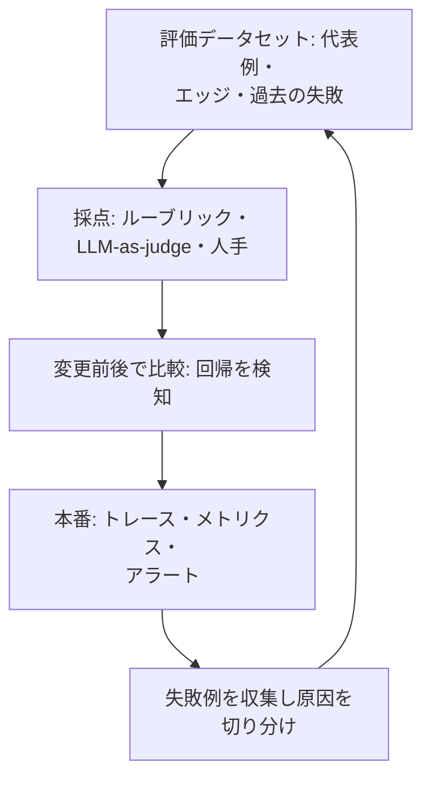

# 知識の俯瞰図

4試験(計27ドメイン)で問われる知識を、試験の枠を越えて **8つのテーマ** に整理したページです。
全体像 → テーマ別の詳細 → 「どの試験のどの章で扱うか」の対応表 の順に見ていきます。

## 1. 全体像

## 2. テーマ別の詳細

### 2-1. プロンプト/コンテキスト設計

### 2-2. エージェント設計

### 2-3. Claude Code の設定の層

### 2-4. 評価と改善のループ

## 3. 試験 × テーマの対応表

各セルのリンクは、そのテーマを扱うノートです(「—」は専用のドメインなし)。

> 割り当ての基準は、各ドメインの主題に最も近いテーマです。専用のドメインがない場合は、ノートの中で扱っている内容で補っています(例: Arch-F 04 は、プロンプトのバージョン管理・テストを扱うため「評価・テスト・デバッグ」に含めています。Arch-F のフックによるガバナンスは、Arch-F 03 のノート内で扱うため「Claude Code」の行に入っています)。

| テーマ | Associate | Developer | Architect Foundations | Architect Professional |
|---|---|---|---|---|
| **プロンプト/コンテキスト設計** | [Assoc 01]({{ site.baseurl }}/claude/associate-foundations/topics/01-prompting-task-execution/notes.html) | [Dev 06]({{ site.baseurl }}/claude/developer-foundations/topics/06-prompt-context-engineering/notes.html) | [Arch-F 04]({{ site.baseurl }}/claude/architect-foundations/topics/04-prompt-engineering/notes.html) [Arch-F 05]({{ site.baseurl }}/claude/architect-foundations/topics/05-context-management/notes.html) | [Arch-P 02]({{ site.baseurl }}/claude/architect-professional/topics/02-models-prompting-context-engineering/notes.html) |
| **API統合・モデル選定・最適化** | [Assoc 03]({{ site.baseurl }}/claude/associate-foundations/topics/03-product-model-selection/notes.html) | [Dev 02]({{ site.baseurl }}/claude/developer-foundations/topics/02-applications-and-integration/notes.html) [Dev 05]({{ site.baseurl }}/claude/developer-foundations/topics/05-model-selection-optimization/notes.html) | — | [Arch-P 02]({{ site.baseurl }}/claude/architect-professional/topics/02-models-prompting-context-engineering/notes.html) [Arch-P 04]({{ site.baseurl }}/claude/architect-professional/topics/04-evaluation-testing-optimization/notes.html) |
| **ツール設計とMCP** | — | [Dev 08]({{ site.baseurl }}/claude/developer-foundations/topics/08-tools-and-mcp/notes.html) | [Arch-F 02]({{ site.baseurl }}/claude/architect-foundations/topics/02-tool-design-mcp/notes.html) | [Arch-P 03]({{ site.baseurl }}/claude/architect-professional/topics/03-integration/notes.html) |
| **エージェント設計** | [Assoc 04]({{ site.baseurl }}/claude/associate-foundations/topics/04-workflow-integration-solution-design/notes.html) | [Dev 01]({{ site.baseurl }}/claude/developer-foundations/topics/01-agents-and-workflows/notes.html) | [Arch-F 01]({{ site.baseurl }}/claude/architect-foundations/topics/01-agentic-architecture/notes.html) | [Arch-P 01]({{ site.baseurl }}/claude/architect-professional/topics/01-solution-design-architecture/notes.html) |
| **Claude Code** | — | [Dev 03]({{ site.baseurl }}/claude/developer-foundations/topics/03-claude-code/notes.html) | [Arch-F 03]({{ site.baseurl }}/claude/architect-foundations/topics/03-claude-code/notes.html) | [Arch-P 07]({{ site.baseurl }}/claude/architect-professional/topics/07-developer-productivity-operational-enablement/notes.html) |
| **評価・テスト・デバッグ** | [Assoc 02]({{ site.baseurl }}/claude/associate-foundations/topics/02-output-evaluation-validation/notes.html) [Assoc 07]({{ site.baseurl }}/claude/associate-foundations/topics/07-troubleshooting-escalation/notes.html) | [Dev 04]({{ site.baseurl }}/claude/developer-foundations/topics/04-eval-testing-debugging/notes.html) | [Arch-F 04]({{ site.baseurl }}/claude/architect-foundations/topics/04-prompt-engineering/notes.html) | [Arch-P 04]({{ site.baseurl }}/claude/architect-professional/topics/04-evaluation-testing-optimization/notes.html) |
| **ガバナンス・安全性** | [Assoc 06]({{ site.baseurl }}/claude/associate-foundations/topics/06-governance-risk-responsible-use/notes.html) | [Dev 07]({{ site.baseurl }}/claude/developer-foundations/topics/07-security-and-safety/notes.html) | — | [Arch-P 05]({{ site.baseurl }}/claude/architect-professional/topics/05-governance-safety-risk/notes.html) |
| **組織導入・コミュニケーション** | [Assoc 05]({{ site.baseurl }}/claude/associate-foundations/topics/05-configuration-knowledge-management/notes.html) | — | — | [Arch-P 06]({{ site.baseurl }}/claude/architect-professional/topics/06-stakeholder-communication-lifecycle/notes.html) [Arch-P 07]({{ site.baseurl }}/claude/architect-professional/topics/07-developer-productivity-operational-enablement/notes.html) |

## 4. 試験別のドメインと配点

### Associate – Foundations

> Assoc 07 のフォルダ名は `07-troubleshooting-escalation` ですが、公式のドメイン名は「Troubleshooting and Optimization」です(リンク切れを避けるためフォルダ名は変えていません)。

| ドメイン | 名称 | 配点 |
|---|---|---|
| [Assoc 01]({{ site.baseurl }}/claude/associate-foundations/topics/01-prompting-task-execution/notes.html) | Prompting and Task Execution | 14% |
| [Assoc 02]({{ site.baseurl }}/claude/associate-foundations/topics/02-output-evaluation-validation/notes.html) | Output Evaluation and Validation | 21% |
| [Assoc 03]({{ site.baseurl }}/claude/associate-foundations/topics/03-product-model-selection/notes.html) | Product and Model Selection | 12% |
| [Assoc 04]({{ site.baseurl }}/claude/associate-foundations/topics/04-workflow-integration-solution-design/notes.html) | Workflow Integration and Solution Design | 16% |
| [Assoc 05]({{ site.baseurl }}/claude/associate-foundations/topics/05-configuration-knowledge-management/notes.html) | Configuration and Knowledge Management | 12% |
| [Assoc 06]({{ site.baseurl }}/claude/associate-foundations/topics/06-governance-risk-responsible-use/notes.html) | Governance, Risk, and Responsible Use | 15% |
| [Assoc 07]({{ site.baseurl }}/claude/associate-foundations/topics/07-troubleshooting-escalation/notes.html) | Troubleshooting and Optimization | 10% |

### Developer – Foundations

| ドメイン | 名称 | 配点 |
|---|---|---|
| [Dev 01]({{ site.baseurl }}/claude/developer-foundations/topics/01-agents-and-workflows/notes.html) | Agents and Workflows | 14.7% |
| [Dev 02]({{ site.baseurl }}/claude/developer-foundations/topics/02-applications-and-integration/notes.html) | Applications and Integration | 33.1% |
| [Dev 03]({{ site.baseurl }}/claude/developer-foundations/topics/03-claude-code/notes.html) | Claude Code | 3.1% |
| [Dev 04]({{ site.baseurl }}/claude/developer-foundations/topics/04-eval-testing-debugging/notes.html) | Eval, Testing, and Debugging | 2.6% |
| [Dev 05]({{ site.baseurl }}/claude/developer-foundations/topics/05-model-selection-optimization/notes.html) | Model Selection and Optimization | 16.8% |
| [Dev 06]({{ site.baseurl }}/claude/developer-foundations/topics/06-prompt-context-engineering/notes.html) | Prompt and Context Engineering | 11.0% |
| [Dev 07]({{ site.baseurl }}/claude/developer-foundations/topics/07-security-and-safety/notes.html) | Security and Safety | 8.1% |
| [Dev 08]({{ site.baseurl }}/claude/developer-foundations/topics/08-tools-and-mcp/notes.html) | Tools and MCPs | 10.6% |

### Architect – Foundations

| ドメイン | 名称 | 配点 |
|---|---|---|
| [Arch-F 01]({{ site.baseurl }}/claude/architect-foundations/topics/01-agentic-architecture/notes.html) | Agentic Architecture | 27% |
| [Arch-F 02]({{ site.baseurl }}/claude/architect-foundations/topics/02-tool-design-mcp/notes.html) | Tool Design & MCP | 18% |
| [Arch-F 03]({{ site.baseurl }}/claude/architect-foundations/topics/03-claude-code/notes.html) | Claude Code | 20% |
| [Arch-F 04]({{ site.baseurl }}/claude/architect-foundations/topics/04-prompt-engineering/notes.html) | Prompt Engineering | 20% |
| [Arch-F 05]({{ site.baseurl }}/claude/architect-foundations/topics/05-context-management/notes.html) | Context Management | 15% |

### Architect – Professional

| ドメイン | 名称 | 配点 |
|---|---|---|
| [Arch-P 01]({{ site.baseurl }}/claude/architect-professional/topics/01-solution-design-architecture/notes.html) | Solution Design & Architecture | 17% |
| [Arch-P 02]({{ site.baseurl }}/claude/architect-professional/topics/02-models-prompting-context-engineering/notes.html) | Claude Models, Prompting & Context Engineering | 13% |
| [Arch-P 03]({{ site.baseurl }}/claude/architect-professional/topics/03-integration/notes.html) | Integration | 19% |
| [Arch-P 04]({{ site.baseurl }}/claude/architect-professional/topics/04-evaluation-testing-optimization/notes.html) | Evaluation, Testing & Optimization | 16% |
| [Arch-P 05]({{ site.baseurl }}/claude/architect-professional/topics/05-governance-safety-risk/notes.html) | Governance, Safety & Risk Management | 14% |
| [Arch-P 06]({{ site.baseurl }}/claude/architect-professional/topics/06-stakeholder-communication-lifecycle/notes.html) | Stakeholder Communication & Lifecycle Management | 14% |
| [Arch-P 07]({{ site.baseurl }}/claude/architect-professional/topics/07-developer-productivity-operational-enablement/notes.html) | Developer Productivity & Operational Enablement | 7% |
